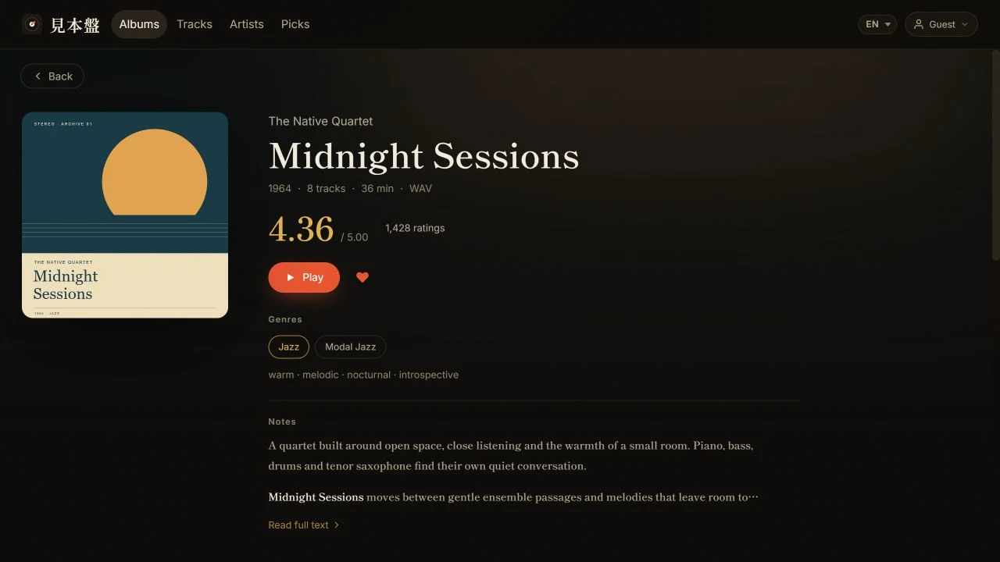

# mihonban / 見本盤

[English](README.md) · [简体中文](README.zh.md) · [繁體中文](README.zh-Hant.md) · [日本語](README.ja.md) · [한국어](README.ko.md) · [Français](README.fr.md) · [Español](README.es.md)

Mihonban es una biblioteca musical privada y autoalojada con un reproductor web adaptable. Puedes ejecutarla localmente con Node y SQLite, usar el emulador D1 local de Wrangler o desplegar la misma aplicación en Cloudflare Workers y D1. Los archivos de audio permanecen en un almacenamiento bajo tu control.

## Vista previa

Capturas de la aplicación real con datos ficticios y portadas originales de demostración o imágenes de portada predeterminadas. [Detalles de las capturas](docs/images/README.es.md).


<details>
<summary>Detalles del álbum y aplicaciones Android / iOS nativas</summary>

**Detalles del álbum en la Web**



| Biblioteca Android | Reproductor Android |
|:---:|:---:|
|  |  |

Aplicación iOS nativa capturada en el simulador, con datos ficticios e imágenes de portada predeterminadas.

| Biblioteca iPhone | Reproductor iPhone |
|:---:|:---:|
|  |  |

**Detalles del álbum en iPad**


</details>

## Características principales

- Vistas adaptables de álbumes, pistas, artistas, favoritos, importación y administración
- Créditos ordenados de varios artistas por álbum y colaboraciones por pista, con búsqueda, página y enlace del reproductor para cada artista
- Contraseñas separadas para oyentes y administradores, además de un modo invitado opcional, sin contraseña y de solo lectura
- Cola persistente, controles móviles completos de pista anterior／reproducir-pausar／pista siguiente, inicio dentro del gesto del usuario, reproducción aleatoria/repetición, búsqueda Range y controles Media Session
- Cliente de escritorio nativo para Windows en [`desktop/`](desktop/README.es.md) (egui + Rodio), distribuido como exe portátil en la [página de Releases](https://github.com/hanfdev/mihonban/releases)
- Cliente Android nativo en [`android/`](android/README.es.md) (Kotlin + Jetpack Compose + Media3), con reproducción en segundo plano, descargas sin conexión y administración nativa
- Cliente iPhone/iPad nativo en [`ios/`](ios/README.es.md) (SwiftUI + SFBAudioEngine), con reproducción en segundo plano, descargas y diseños para ambos tamaños
- Almacenamientos con nombre para OneDrive, WebDAV, Google Drive y carpetas locales exclusivas del runtime Node
- Espejo de imágenes R2 opcional y autorreparable para portadas, galerías y retratos de artistas
- Importación mediante la API de Discogs y actualizaciones RYM desde HTML guardado o una extensión opcional de Chrome/Edge, con lotes de valoraciones iniciados por el usuario
- Compañero Python opcional para carpetas de entrada, archivos comprimidos simples o anidados, reparación de etiquetas y sincronización con la nube
- Interfaces en inglés, chino simplificado, chino tradicional, japonés, coreano, francés y español
- Herramientas de migración SQLite／D1 y un Worker proxy de audio firmado opcional

## Entornos de ejecución

| Entorno | Base de metadatos | Almacenamiento de archivos | Uso habitual |
|---|---|---|---|
| Node | `<DATA_DIR>/mihonban.sqlite` | OneDrive, WebDAV, Google Drive, carpeta local | Red local, NAS, VPS |
| Wrangler local | D1／KV locales dentro de `.wrangler/` | OneDrive, WebDAV, Google Drive | Desarrollo compatible con Cloudflare |
| Cloudflare | D1 + KV, R2 opcional | OneDrive, WebDAV, Google Drive | Despliegue serverless siempre disponible |

El compañero Python es opcional en todos los entornos. Instálalo únicamente si necesitas vigilar una carpeta de entrada local, extraer archivos, organizar etiquetas o conciliar datos locales y de la nube.

## Inicio rápido

Clona el repositorio oficial:

```bash
git clone https://github.com/hanfdev/mihonban.git
cd mihonban
```

### Aplicación Wrangler local

En Windows, el script auxiliar prepara los archivos de compilación fuera de OneDrive e inicia Wrangler.

```powershell
tools\cloud-dev.cmd
```

Abre `http://127.0.0.1:8787`; por defecto, el servidor de desarrollo solo escucha en `http://127.0.0.1:8787` (loopback). Establece `MIHONBAN_DEV_LAN=1` y permite Node.js en el cortafuegos de Windows para probar desde un teléfono mediante `http://<computer-lan-ip>:8787`. El primer archivo de secretos generado por el asistente contiene contraseñas de oyente y de administrador generadas aleatoriamente (consulta `.dev.vars` en el directorio de preparación). Cambia ambas en Administración antes de compartir el servicio.

Para configurar Wrangler manualmente, consulta [Instalación y despliegue](docs/install.es.md).

### Aplicación local Node + SQLite

```bash
cd cloud/web
npm ci
npm run build
cd ../worker
npm ci
# Copia .env.example como .env, sustituye todos los valores de ejemplo y establece DEV_INSECURE_COOKIE=1 para HTTP local.
npm run node
```

Node escucha en `0.0.0.0:8788` de forma predeterminada. Si no se define `DATA_DIR`, la base de datos se crea en `cloud/worker/data/mihonban.sqlite`. Node no incluye contraseñas predefinidas: `.env` debe definir `APP_PASSWORD`, `ADMIN_PASSWORD` y un `SESSION_SECRET` de al menos 32 caracteres.

### Cloudflare

Compila la aplicación web, crea D1 y KV, configura los secretos del Worker, aplica `schema.sql` y despliega. El procedimiento manual es el método de referencia; el compañero Python local no es obligatorio. Lee [Instalación y despliegue](docs/install.es.md) y [Migración de la base de datos](docs/database-migration.es.md) antes de trasladar un catálogo local existente.

### Compañero Python opcional

```bash
python -m venv .venv
# Windows: .venv\Scripts\activate
# POSIX:   source .venv/bin/activate
pip install -e ./pipeline
mihonban setup
mihonban doctor
```

Mantén `music_root`, `data_dir`, las bases de datos y los archivos temporales fuera de OneDrive, Dropbox, iCloud y cualquier otro directorio sincronizado.

## Datos y copias de seguridad

| Datos | Fuente autoritativa | Método de copia de seguridad |
|---|---|---|
| Álbumes, pistas, artistas, favoritos y notas | SQLite en Node o D1 | Copia compatible con SQLite o exportación SQL lógica |
| Almacenamientos con nombre, R2 y ajustes de módulos | Ajustes de la base de datos | JSON de ajustes de Administración, guardado cifrado |
| Secretos iniciales de contraseñas, sesión, compañero y proxy | Entorno de ejecución | Registro separado en un gestor de contraseñas |
| Audio e imágenes originales | Backend de almacenamiento configurado | Copia independiente en el proveedor de almacenamiento |
| Espejo de imágenes R2 y cachés KV | Caché reconstruible | Mismo bucket R2: migrar o recuperar el índice. Bucket nuevo: precalentar. No migrar KV |

El JSON de ajustes de Administración no es una copia del catálogo, y una copia de la base de datos no contiene los archivos de audio.

## Estructura del repositorio

| Ruta | Función |
|---|---|
| `cloud/web/` | Reproductor React e interfaz de administración |
| `cloud/worker/` | API Hono, esquema D1 y runtime compatible con Node |
| `cloud/proxy-worker/` | Relé de audio firmado opcional |
| `desktop/` | Cliente de escritorio nativo para Windows (Rust, egui) |
| `android/` | Cliente Android nativo (Kotlin, Jetpack Compose, Media3) |
| `ios/` | Cliente iPhone/iPad nativo (SwiftUI, SFBAudioEngine) |
| `extensions/rym/` | Extensión opcional Chrome/Edge para capturar páginas RYM y actualizar valoraciones |
| `pipeline/` | CLI de Python `mihonban` y canal de importación／sincronización |
| `config/` | Plantillas de configuración seguras |
| `tools/` | Herramientas de desarrollo local, despliegue, vigilancia y migración |
| `tests/` | Pruebas de regresión de Python |

## Comandos habituales

```text
mihonban setup                  create local companion config
mihonban doctor                 verify dependencies and paths
mihonban ingest --apply         process inbox archives or album folders
mihonban watch                  watch the inbox and reconcile cloud data
mihonban cloud sync             upload/register local albums
mihonban cloud pull             pull web imports back to the local library
mihonban rym parse|match|write  process manually saved RYM HTML

node tools/check-docs.mjs
cd cloud/worker && npm test
cd cloud/proxy-worker && npm test
cd cloud/web && npm test && npm run build
python -m pytest -q
```

## Seguridad

- Nunca confirmes en Git `.dev.vars`, `.env`, `mihonban.toml`, `rclone.conf`, bases de datos, exportaciones de ajustes, tokens ni archivos de audio.
- HTTP local requiere `DEV_INSECURE_COOKIE=1`. Los despliegues públicos deben usar HTTPS y dejar esta variable sin definir.
- Las contraseñas guardadas en Administración prevalecen sobre las contraseñas iniciales del entorno y revocan las sesiones existentes.
- Si se habilita el proxy externo, conserva `STREAM_PROXY_SECRET` y `PROXY_SECRET` con el mismo valor y en privado.
- Los lotes RYM solo se ejecutan cuando un administrador inicia la cola del navegador y se pausan ante verificaciones o límites de solicitudes. El servidor no rastrea RYM. Consulta la [guía de uso](docs/manual.es.md).
- Guarda al menos una copia independiente de cualquier archivo de audio irremplazable.

## Documentación

| Guía | Idiomas |
|---|---|
| Instalación y despliegue | [English](docs/install.md) · [简体中文](docs/install.zh.md) · [繁體中文](docs/install.zh-Hant.md) · [日本語](docs/install.ja.md) · [한국어](docs/install.ko.md) · [Français](docs/install.fr.md) · [Español](docs/install.es.md) |
| Arquitectura y entornos | [English](docs/cloud.md) · [简体中文](docs/cloud.zh.md) · [繁體中文](docs/cloud.zh-Hant.md) · [日本語](docs/cloud.ja.md) · [한국어](docs/cloud.ko.md) · [Français](docs/cloud.fr.md) · [Español](docs/cloud.es.md) |
| Uso diario | [English](docs/manual.md) · [简体中文](docs/manual.zh.md) · [繁體中文](docs/manual.zh-Hant.md) · [日本語](docs/manual.ja.md) · [한국어](docs/manual.ko.md) · [Français](docs/manual.fr.md) · [Español](docs/manual.es.md) |
| Migración de la base de datos | [English](docs/database-migration.md) · [简体中文](docs/database-migration.zh.md) · [繁體中文](docs/database-migration.zh-Hant.md) · [日本語](docs/database-migration.ja.md) · [한국어](docs/database-migration.ko.md) · [Français](docs/database-migration.fr.md) · [Español](docs/database-migration.es.md) |
| Almacenamiento y migración de archivos | [English](docs/storage.md) · [简体中文](docs/storage.zh.md) · [繁體中文](docs/storage.zh-Hant.md) · [日本語](docs/storage.ja.md) · [한국어](docs/storage.ko.md) · [Français](docs/storage.fr.md) · [Español](docs/storage.es.md) |
| Alojamiento serverless | [English](docs/serverless-hosting.md) · [简体中文](docs/serverless-hosting.zh.md) · [繁體中文](docs/serverless-hosting.zh-Hant.md) · [日本語](docs/serverless-hosting.ja.md) · [한국어](docs/serverless-hosting.ko.md) · [Français](docs/serverless-hosting.fr.md) · [Español](docs/serverless-hosting.es.md) |
| Proxy de audio opcional | [English](docs/audio-proxy.md) · [简体中文](docs/audio-proxy.zh.md) · [繁體中文](docs/audio-proxy.zh-Hant.md) · [日本語](docs/audio-proxy.ja.md) · [한국어](docs/audio-proxy.ko.md) · [Français](docs/audio-proxy.fr.md) · [Español](docs/audio-proxy.es.md) |
| Publicación segura | [English](docs/github-publish.md) · [简体中文](docs/github-publish.zh.md) · [繁體中文](docs/github-publish.zh-Hant.md) · [日本語](docs/github-publish.ja.md) · [한국어](docs/github-publish.ko.md) · [Français](docs/github-publish.fr.md) · [Español](docs/github-publish.es.md) |
| Cliente nativo de Windows | [English](desktop/README.md) · [简体中文](desktop/README.zh.md) · [繁體中文](desktop/README.zh-Hant.md) · [日本語](desktop/README.ja.md) · [한국어](desktop/README.ko.md) · [Français](desktop/README.fr.md) · [Español](desktop/README.es.md) |
| Contrato de compatibilidad API de clientes nativos | [English](desktop/API_COMPATIBILITY.md) · [简体中文](desktop/API_COMPATIBILITY.zh.md) · [繁體中文](desktop/API_COMPATIBILITY.zh-Hant.md) · [日本語](desktop/API_COMPATIBILITY.ja.md) · [한국어](desktop/API_COMPATIBILITY.ko.md) · [Français](desktop/API_COMPATIBILITY.fr.md) · [Español](desktop/API_COMPATIBILITY.es.md) |
| Datos de regresión de búsqueda de audio | [English](desktop/tests/fixtures/README.md) · [简体中文](desktop/tests/fixtures/README.zh.md) · [繁體中文](desktop/tests/fixtures/README.zh-Hant.md) · [日本語](desktop/tests/fixtures/README.ja.md) · [한국어](desktop/tests/fixtures/README.ko.md) · [Français](desktop/tests/fixtures/README.fr.md) · [Español](desktop/tests/fixtures/README.es.md) |
| Cliente Android | [English](android/README.md) · [简体中文](android/README.zh.md) · [繁體中文](android/README.zh-Hant.md) · [日本語](android/README.ja.md) · [한국어](android/README.ko.md) · [Français](android/README.fr.md) · [Español](android/README.es.md) |
| Validación de Android | [English](android/VERIFICATION.md) · [简体中文](android/VERIFICATION.zh.md) · [繁體中文](android/VERIFICATION.zh-Hant.md) · [日本語](android/VERIFICATION.ja.md) · [한국어](android/VERIFICATION.ko.md) · [Français](android/VERIFICATION.fr.md) · [Español](android/VERIFICATION.es.md) |
| Cliente para iPhone y iPad | [English](ios/README.md) · [简体中文](ios/README.zh.md) · [繁體中文](ios/README.zh-Hant.md) · [日本語](ios/README.ja.md) · [한국어](ios/README.ko.md) · [Français](ios/README.fr.md) · [Español](ios/README.es.md) |
| Extensión RYM del navegador | [English](extensions/rym/README.md) · [简体中文](extensions/rym/README.zh.md) · [繁體中文](extensions/rym/README.zh-Hant.md) · [日本語](extensions/rym/README.ja.md) · [한국어](extensions/rym/README.ko.md) · [Français](extensions/rym/README.fr.md) · [Español](extensions/rym/README.es.md) |
| Regresiones de listas en el navegador | [English](cloud/web/test/browser/README.md) · [简体中文](cloud/web/test/browser/README.zh.md) · [繁體中文](cloud/web/test/browser/README.zh-Hant.md) · [日本語](cloud/web/test/browser/README.ja.md) · [한국어](cloud/web/test/browser/README.ko.md) · [Français](cloud/web/test/browser/README.fr.md) · [Español](cloud/web/test/browser/README.es.md) |
| Capturas y reproducción | [English](docs/images/README.md) · [简体中文](docs/images/README.zh.md) · [繁體中文](docs/images/README.zh-Hant.md) · [日本語](docs/images/README.ja.md) · [한국어](docs/images/README.ko.md) · [Français](docs/images/README.fr.md) · [Español](docs/images/README.es.md) |

## Licencia

Mihonban se distribuye bajo la [GNU Affero General Public License v3.0](LICENSE) (`AGPL-3.0-only`). Si modificas el software y lo ofreces a través de una red, la AGPL exige que pongas a disposición el código fuente correspondiente a esa versión.

La licencia solo cubre el código y las plantillas seguras de este repositorio. No concede derechos para distribuir música ni metadatos de terceros.
