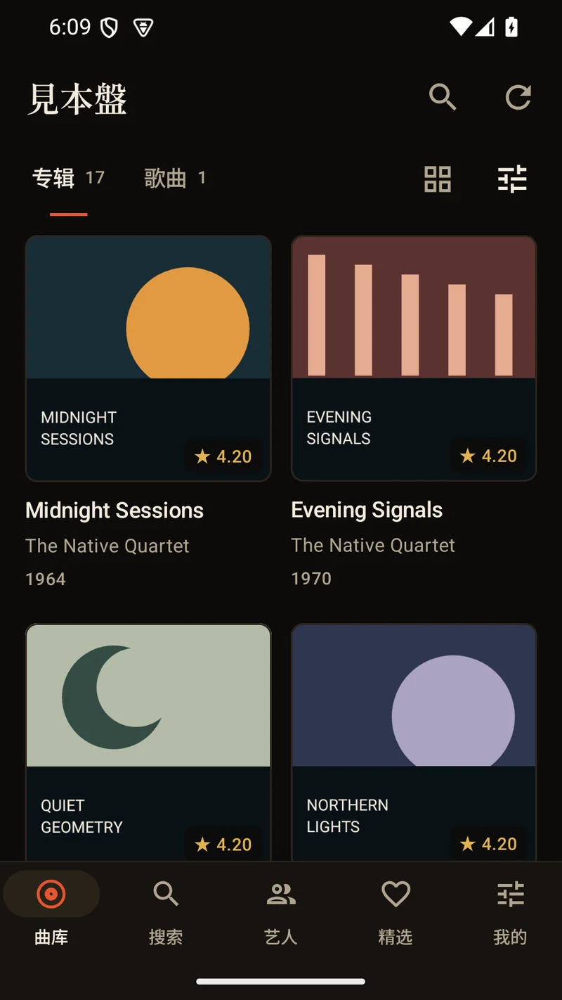
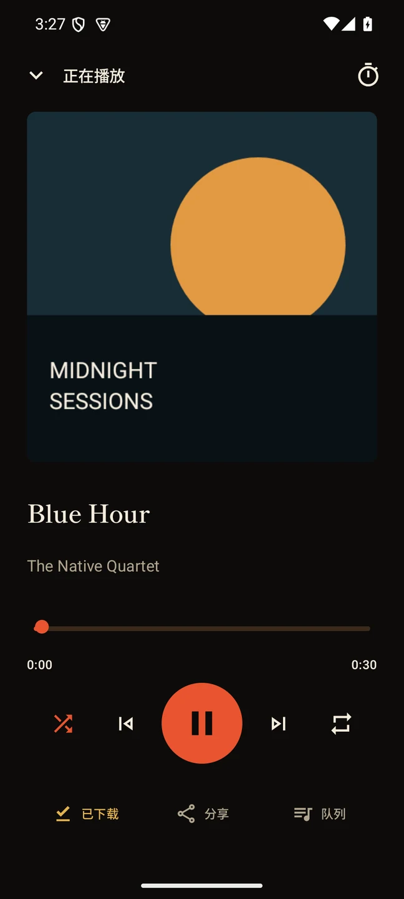

# Mihonban para Android

[English](README.md) · [简体中文](README.zh.md) · [繁體中文](README.zh-Hant.md) · [日本語](README.ja.md) · [한국어](README.ko.md) · [Français](README.fr.md) · [Español](README.es.md)

Cliente nativo Kotlin / Jetpack Compose para un servidor Mihonban existente. No utiliza WebView. Requiere Android 8.0 (API 26) o posterior.

## Vista previa

Capturas reales del cliente Android nativo con datos de prueba ficticios y portadas originales de demostración. [Detalles de las capturas](../docs/images/README.es.md).

| Biblioteca Android | Reproductor Android |
|:---:|:---:|
|  |  |

## Conexión

Compila localmente la versión preliminar 0.1.10 o descarga el APK debug de una [ejecución Android correcta](https://github.com/hanfdev/mihonban/actions/workflows/android.yml). El APK release necesita tu propia clave de firma. Introduce la dirección raíz del servidor, por ejemplo `https://music.example.com` o `http://192.168.1.20:8788`, y la contraseña de oyente o administrador. Déjala vacía solo si el servidor permite invitados. Un emulador Android accede al servidor de desarrollo del anfitrión mediante `http://10.0.2.2:8788`.

Se recomienda HTTPS para servidores remotos. Los modos existentes de desarrollo Node/Wrangler admiten HTTP local; el servidor debe usar `DEV_INSECURE_COOKIE=1` para sesiones con cookies por HTTP. La aplicación no omite la validación de certificados TLS.

## Funciones nativas

- Cuadrícula de álbumes y listas de pistas, filtro de género, orden por año/título/artista/nota/adición reciente, búsqueda global, créditos de varios artistas y discografías.
- Detalles de álbum, notas, descripciones, álbumes relacionados, páginas del libreto y zoom con dos dedos, hoja de compartir Android, favoritos compartidos de álbumes y canciones.
- Minirreproductor y reproductor completo, búsqueda temporal, aleatorio, repetición, cola editable, reproducir después, temporizador, foco de audio y gestión de desconexión de auriculares.
- Servicio Media3 de reproducción en primer plano con controles en notificaciones, auriculares y pantalla bloqueada. Sigue reproduciendo con la interfaz en segundo plano; tras reiniciar el proceso, restaura la cola en pausa.
- Descargas WorkManager al almacenamiento privado, progreso, pausa/reintento/eliminación, reanudación mediante rangos de bytes validados, metadatos y portadas persistentes, reproducción sin conexión y navegación del catálogo en caché.
- Administración: editar álbumes/pistas/artistas, visibilidad, eliminación confirmada, importar metadatos y libreto de Discogs, reordenar imágenes, subir audio con el selector de documentos Android, explorar y registrar carpetas del servidor.
- Gestión del servidor: invitados y módulos, configuración/prueba/destino de escritura de almacenamientos con nombre, configuración/prueba R2, bandeja de entrada de fuentes y análisis, cambio de contraseñas de oyente/administrador.
- Conserva la paleta Web: superficies marrón oscuro, texto marfil cálido, acentos bermellón y títulos con serifas. Objetivos táctiles, navegación inferior, restauración del desplazamiento, Atrás del sistema, rotación y márgenes Android usan Compose nativo.

El catálogo abre directamente álbumes o pistas. La barra superior se oculta al desplazarse hacia arriba y vuelve al bajar. La densidad de cuadrícula es ajustable; género y orden están en un panel inferior que puede cerrarse. La búsqueda ofrece géneros existentes, álbumes recientes y categorías de resultados. Los detalles colocan portada y metadatos lado a lado, con acciones secundarias en un menú. El estado de pestañas se guarda por servidor y rol de acceso. El orden de adición reciente usa la fecha de creación original: editar notas u otros metadatos no lleva un álbum antiguo al principio.

La versión 0.1.3 reemplaza la expansión de la descripción en la página por un lector dedicado. El álbum mantiene un extracto de texto plano de tres líneas. El lector fija cabecera y botón Cerrar, ofrece volver arriba, restaura la posición del álbum al cerrarse y recuerda el punto de lectura al reabrirse. CommonMark y tablas/tachado GFM se renderizan nativamente, con texto seleccionable, listas anidadas, citas, enlaces, código, separadores e imágenes independientes. Tablas anchas y código se desplazan horizontalmente. El HTML sin procesar permanece como texto inerte. Sigue la paleta y tipografía Web sin WebView.

La versión 0.1.4 hace visibles los fallos de imágenes: indicación de carga, texto alternativo legible y botón de reintento sustituyen el espacio vacío. El reintento solo recarga esa imagen y mantiene abierto el lector. Las direcciones inutilizables muestran una explicación sin ofrecer un reintento imposible.

La versión 0.1.5 corrige Volver arriba para descripciones con un único párrafo largo o cita. Tiene en cuenta el desplazamiento dentro de bloques Markdown y oculta de nuevo el botón al principio. La familia tipográfica de títulos se comparte entre recreaciones de Activity para no reasignar repetidamente los búferes de fuentes incluidas.

La versión 0.1.6 cancela solicitudes de descarga activas cuando se detiene su trabajo WorkManager, incluso si el servidor se atasca antes de las cabeceras o durante el cuerpo. Pausar o eliminar libera la solicitud sin esperar al tiempo de espera de red. Las portadas usan la misma cancelación. El reintento manual empieza de cero; los automáticos pueden reanudar datos parciales validados.

La versión 0.1.7 muestra imágenes de descripción aunque compartan párrafo con texto o leyendas. Texto e imágenes conservan orden original, espacios legibles y formato Markdown circundante, también en citas anidadas. Mantienen los indicadores de carga y la opción de reintento.

La versión 0.1.8 aleja los controles verticales del borde inferior y acerca portada y título. Una fila inferior ofrece descarga de la pista actual, compartir y cola. Las descargas muestran progreso y permiten pausa/reintento; los archivos completados se conservan. Compartir abre el selector Android con canción, artista y enlace al álbum Web. En horizontal, la fila queda bajo la portada para reservar espacio a los datos. El reproductor completo sigue mostrando solo título y artistas como metadatos.

La versión 0.1.9 usa por defecto nota ponderada, con el mismo ajuste de confianza y desempates que el Web. Tocar un género principal o secundario abre los álbumes coincidentes en ese orden; Atrás vuelve al álbum. La barra plegada recorta por completo título e iconos sin perder el área de estado del sistema.

La versión 0.1.10 corrige fragmentos de títulos/iconos cuando la barra casi está plegada. Desliza fuera una barra de altura completa en lugar de centrar controles en una franja decreciente, mide la distancia real y desvanece el tramo final. Conserva la posición cerrada al cambiar la escala de pantalla. El margen de la barra de estado queda fuera de la fila móvil.

More → Playback settings ofrece precarga de la siguiente pista: solo Wi-Fi (predeterminado), siempre y desactivada. Solo Wi-Fi cancela solicitudes anticipadas al pasar la red predeterminada a datos móviles y las reanuda al volver. Sigue la siguiente pista real en aleatorio, espera a que la actual tenga búfer, omite pistas descargadas y se detiene en pausa. Guarda hasta los primeros 16 MiB de la siguiente pista en la caché musical existente por servidor/rol y dentro de su límite; la reproducción reutiliza esos bytes. Es una preferencia del dispositivo, sin permiso de administrador.

Los teléfonos de 320–599 dp tienen modos explícitos de dos/tres columnas; ventanas más estrechas y tabletas también usan cantidades distintas. El botón de cuadrícula es neutro, sin número ni resaltado visible, pero los lectores de pantalla anuncian la cantidad actual. La preferencia persiste tras reiniciar y se comparte entre biblioteca, favoritos y géneros. La biblioteca permite actualizar deslizando. La cola abre en la pista actual, Atrás vuelve al reproductor y vaciarla requiere confirmación.

La versión 0.1.2 mantiene los controles en el área segura disponible y adapta la portada al espacio restante. Los metadatos incluyen solo título y artistas; tocar el título abre el álbum. Durante el almacenamiento en búfer sigue habiendo un botón de reproducción/pausa utilizable. Aleatorio en listas es un selector: no inicia ni cambia la reproducción hasta pulsar Play all. En detalles de álbum inicia ese álbum inmediatamente.

More → Cache settings muestra uso de disco de música/imágenes, permite un límite musical de 128 MB–2 GB y limpia las cachés automáticas. Reducir el límite expulsa inmediatamente música antigua; las imágenes tienen un límite independiente de 64 MB. Descargas explícitas, catálogo guardado e inicio de sesión permanecen; la reproducción activa puede crear caché nueva. Las claves de caché de flujo incluyen servidor y rol.

Los favoritos son una selección compartida y mantenida en el servidor. Como en el Web, oyentes e invitados pueden leerlos y solo administradores modificarlos. URL, instantáneas de catálogo, imágenes y descargas se separan por servidor y rol. Las cookies de sesión se guardan con Android Keystore AES-GCM; las contraseñas no se guardan. Los datos de la aplicación quedan fuera de la copia de seguridad Android.

## Compilación y pruebas

Usa JDK 17 y Android SDK platform 35 / Build Tools 35.0.0. Abre este directorio en Android Studio o ejecuta desde la raíz del repositorio:

```powershell
android\gradlew.bat -p android testDebugUnitTest lintDebug assembleDebug assembleRelease
android\gradlew.bat -p android connectedDebugAndroidTest
```

En macOS/Linux:

```sh
sh android/gradlew -p android testDebugUnitTest lintDebug assembleDebug assembleRelease
sh android/gradlew -p android connectedDebugAndroidTest
```

Define `ANDROID_HOME` o `sdk.dir` en el archivo ignorado `android/local.properties`. El wrapper fija Gradle 8.9. Las pruebas no necesitan servidor de producción, credenciales ni audio. JVM verifica compatibilidad JSON, aislamiento URL/cookies, seguridad de redirecciones y validación de rangos. Las pruebas instrumentadas usan HTTP integrado y PCM sintético para navegación nativa, reproducción, búsqueda temporal, colas, descargas y uso sin conexión.

Salidas:

- APK de desarrollo instalable: `app/build/outputs/apk/debug/app-debug.apk`.
- APK release sin firmar: `app/build/outputs/apk/release/app-release-unsigned.apk`. Fírmalo con tu clave de publicación antes de distribuir y consérvala para las actualizaciones.
- Informes JVM y lint: `app/build/reports/`.

El workflow Android de GitHub Actions compila ambas variantes y ejecuta JVM/lint, con un trabajo independiente de emulador API 35. No publica versiones ni firma con una clave de producción.

Consulta los [resultados de validación](VERIFICATION.es.md) para comandos, resultados registrados y límites de cobertura. Las capturas representativas están en `docs/images/`. APK, colecciones completas de capturas e informes siguen siendo archivos generados y no se incluyen en las fuentes. Los artefactos CI requieren acceso al workflow y caducan según la retención de GitHub.

## Límites actuales

Los formatos dependen de Media3 y los decodificadores del dispositivo, incluidos MP3, FLAC, AAC, WAV, Vorbis y Opus habituales. No incluye DSD/APE ni otros códecs especializados. Las subidas desde el teléfono sobreviven a la rotación, pero son edición en primer plano: mantén abierta la aplicación hasta acabar el registro. No son una cola persistente de subidas en segundo plano. Cancelar antes del registro puede exigir limpiar archivos parciales en el proveedor de almacenamiento.

La interfaz principal de escucha ofrece chino e inglés según el idioma del dispositivo; administración usa actualmente chino simplificado. Las actualizaciones RYM asistidas por navegador, importación de HTML guardado, copia/restauración completa de configuración, migración masiva de almacenamiento y configuración OAuth siguen en la aplicación Web. Este cliente se conecta a un servidor existente; no aloja uno.

Licencia AGPL-3.0-only del repositorio. Las dependencias externas conservan sus licencias. Shippori Mincho y GenRyu Mincho coinciden con las fuentes del Web; sus SIL Open Font Licenses están en `app/src/main/assets/licenses/`.
