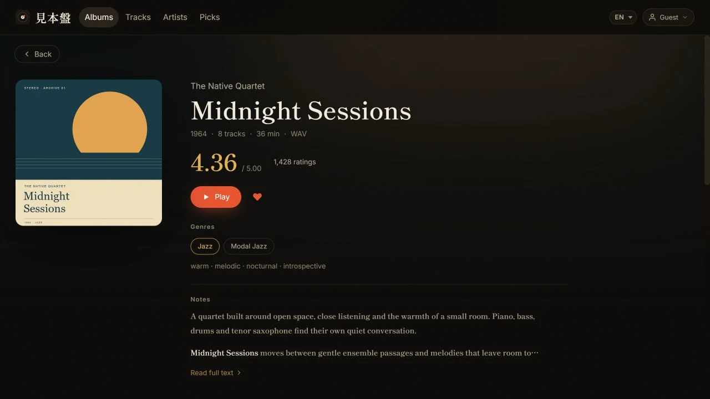

# Guide d’utilisation quotidienne

[English](manual.md) · [简体中文](manual.zh.md) · [繁體中文](manual.zh-Hant.md) · [日本語](manual.ja.md) · [한국어](manual.ko.md) · [Français](manual.fr.md) · [Español](manual.es.md)

Ce guide s’adresse aux administrateurs de bibliothèque. Les chemins et les URL dépendent de la runtime sélectionnée et de votre configuration privée.

## Points d’entrée

| Point d’entrée | But |
|---|---|
| Application web | Parcourir, jouer, rechercher, mettre en favori, importer et administrer |
| Boîte de réception locale | Dossiers optionnels ou archives RAR/ZIP/7z traités par le compagnon Python |
| `mihonban` CLI | Diagnostiquer, ingérer, surveiller, synchroniser, extraire et traiter RYM pages enregistrées |

Le compagnon Python et tout lecteur de bureau ne sont pas nécessaires pour la lecture web.

## Identités

- Mot de passe de l’auditeur : parcourir et lire du contenu authentifié.
- Mot de passe administrateur : télécharger, modifier, masquer, supprimer, mettre en favori, commander et configurer l’infrastructure.
- Mode invité sans mot de passe : accès optionnel en lecture seule sans saisie de mot de passe.
- Clé compagnon : identifiant machine pour le pipeline local optionnel.

Tous les scripts d’assistance génèrent des mots de passe aléatoires lorsqu’aucun n’est fourni ; rien n’est livré avec un mot de passe par défaut fixe. Les mots de passe de développement local se trouvent dans le fichier `.dev.vars` du répertoire de préparation.

Les mots de passe enregistrés dans Admin dépassent les valeurs de démarrage de l’environnement Admin. Changer l’un ou l’autre mot de passe révoque les sessions existantes.

## Lecture et interactions mobiles

La page d’album Web réunit pochette, métadonnées, pistes et commandes de lecture. Cette capture utilise des données fictives et des pochettes originales de démonstration. [Détails des captures](images/README.fr.md).



- Le tri **Ajoutés** de la bibliothèque web et la liste des imports récents utilisent la date du premier ajout de l’album. Modifier la note, le titre ou d’autres données, ou analyser à nouveau un album existant, ne le ramène pas en tête. La liste Artistes utilise l’ajout le plus récent parmi les albums actuellement visibles de chaque artiste. Les albums ajoutés au même instant gardent un ordre stable ; les dates inconnues sont classées en dernier.
- Albums, Artistes, Titres et Sélection mémorisent chacun leur position de défilement tant que la page reste ouverte : en y revenant, vous reprenez là où vous vous étiez arrêté, et une page pas encore visitée s’ouvre en haut. Les pages d’album et d’artiste s’ouvrent toujours en haut, et le retour vous ramène à la position de la liste d’origine. Cliquez de nouveau sur le logo ou l’élément de navigation actif pour remonter en douceur ; les onglets Albums et Morceaux de la page Sélection suivent la même règle.
- Le volume, la langue et le tri sont enregistrés par origin du navigateur. Un nouveau nom d’hôte ou domaine personnalisé repart avec de nouvelles préférences ; sans valeur enregistrée, le volume commence à 100 %.
- La lecture démarre dans l’événement de toucher/clic d’origine afin qu’Android Chrome puisse établir une lecture audible et une session multimédia système. Sur les navigateurs compatibles, l’écran verrouillé/la notification permet lecture, pause, piste précédente/suivante et recherche. Si le tampon audio d’iOS Safari s’épuise, Mihonban fige la chronologie multimédia du système et ne la relance qu’une fois l’audio de nouveau lisible, afin que la progression silencieuse ne devance pas le son.
- Sur mobile, touchez la pochette ou la zone vide du mini-lecteur, ou faites glisser le mini-lecteur vers le haut, pour ouvrir l’écran de lecture. Les liens d’album et d’artiste restent indépendants.
- Le mini-lecteur mobile affiche toujours, dans cet ordre, piste précédente, lecture/pause et piste suivante. La lecture aléatoire et la répétition restent disponibles dans l’écran de lecture complet.
- Un état de chargement apparaît pendant le changement d’image du livret ; balayez horizontalement pour passer à l’image précédente ou suivante.
- Les grilles d’albums préchargent les pochettes proches de la fenêtre et conservent un espace réservé discret jusqu’à la fin du décodage. Les pochettes déjà décodées restent prêtes après un filtrage ou un tri, et les échecs d’image temporaires déclenchent un petit nombre de nouvelles tentatives différées. Dans la bibliothèque de bureau avec pointeur précis, les pochettes au repos sont légèrement atténuées et retrouvent leurs couleurs d’origine au survol, au focus clavier ou pendant la lecture. Les débits d’au moins 1000 kbps utilisent une notation compacte en `M` ; survolez la valeur pour afficher le nombre exact de kbps.

## Dossiers et archives de la boîte de réception

1. Mettez un dossier d’album ou une archive que vous êtes autorisé à utiliser dans le `inbox` configuré.
2. Exécuter `mihonban watch`, ou traiter une fois avec `mihonban ingest --apply`.
3. Réviser les journaux et les rapports de quarantaine ; les échecs difficiles ne sont jamais ignorés silencieusement.
4. Lorsque la synchronisation cloud est configurée, exécutez `mihonban cloud sync`.

Le pipeline prend en charge les dossiers directs, une archive et des archives imbriquées. Il attend trois sondages inchangés avant de traiter afin que les fichiers partiellement copiés ne soient pas ouverts. Le travail se déroule dans une zone temporaire privée. Les éléments sources réussis sont transférés à `_done` ; les échecs graves et leur rapport passent à `_quarantine`.

Le pipeline extrait, répare l’encodage des noms de fichiers japonais, exécute l’organisation des métadonnées/tags, normalise la disposition de la bibliothèque et peut enregistrer le résultat avec l’API. Les métadonnées ambiguës restent disponibles pour une consultation manuelle.

## Analyse des sources cloud et surveillance locale

Le module source Admin lit les titres et liens RSS/Atom/Blogger pris en charge. Cloudflare Cron ou l’intervalle de Node peuvent l’exécuter lorsque l’ordinateur personnel est éteint. Il ne télécharge ni ne décompacte la musique.

`mihonban watch` nécessite l’accès au `inbox` local, aux fichiers persistants, au 7-Zip et à Beets. Exécutez-le sur Windows, macOS, Linux ou un NAS ; il ne peut pas fonctionner à l’intérieur de Cloudflare Workers.

## Importation web

1. Connectez-vous en tant qu’administrateur et ouvrez l’Importation.
2. Sélectionnez les morceaux appartenant à un album et critiquez l’artiste, le titre, l’année, les noms de fichiers et l’ordre.
3. Choisir/recadrer un recouvrement et sélectionner le stockage destiné à l’écriture.
4. Commencez le téléchargement et attendez que chaque morceau se termine avant de quitter la page.
5. Ouvrez l’album terminé, jouez une piste et cherchez vers la fin.

Une brève coupure de réseau n’enregistre pas silencieusement un fichier audio partiel. OneDrive et Google Drive reprennent les sessions segmentées avec un nombre limité de tentatives ; les téléversements relayés, comme WebDAV, renvoient le fichier complet. Mihonban vérifie la taille exacte stockée avant d’enregistrer l’album et signale une erreur plutôt que d’accepter un objet absent ou tronqué. Conservez le fichier source jusqu’à ce que l’album terminé ait passé le contrôle de lecture.

Sur une page artiste, les administrateurs peuvent modifier le nom romanisé / anglais. Cette valeur au niveau de l’artiste met à jour tous ses albums et reste conservée lors des synchronisations ultérieures du compagnon.

Laissez ce champ vide lorsque le nom d’origine convient déjà à la recherche et au tri. Mihonban conserve la valeur vide et utilise le nom d’origine uniquement comme repli pour la recherche et le tri, sans stocker de doublon.

La fonction Discogs de la page artiste recherche automatiquement des candidats. Si le bon artiste n’apparaît pas, collez une URL officielle `discogs.com/artist/...` pour le charger directement ; la boîte de dialogue permet de prévisualiser et de choisir la photo et la biographie avant l’importation. La vue Artistes trie d’abord par nombre d’albums et n’utilise les participations à des morceaux que pour départager les artistes ayant le même nombre d’albums. Les participations figurent sur une seconde ligne plus discrète et ne comptent pas comme des albums.

L’éditeur d’album définit le crédit d’artiste ordonné par défaut de toute la parution. Dans la gestion des morceaux, le bouton artiste d’un titre permet de définir une collaboration propre à ce titre ; désactivez l’option pour hériter à nouveau des artistes de l’album. Ces crédits alimentent la recherche, le lecteur et les informations média du système. La page d’un invité ne répertorie que les morceaux auxquels il participe et ne lui attribue pas l’album entier. Le compagnon et l’importateur du navigateur privilégient les valeurs structurées multiples `ARTISTS` / `ALBUMARTISTS`. Avec un simple texte d’affichage, les mentions explicites `feat.` / `ft.` / `featuring` sont séparées, de même qu’un simple `A & B` comme `Marcos Valle & Azymuth`. Une liste séparée par des virgules est découpée lorsque chaque élément est un nom complet, c’est-à-dire qu’il contient une espace ou qu’il est écrit en caractères chinois, japonais ou coréens (par exemple `Kazuo Ohtani, Yoshiaki Furuta`). Le texte reste entier si un élément ne compte qu’un seul mot (`Earth, Wind & Fire`, `Yamashita, Tatsuro`), si un élément suivant commence par the, his, her ou their (`Kool & the Gang`, `Bob Marley, The Wailers`), ou si un identifiant d’artiste MusicBrainz unique indique un seul artiste. Un nom combiné que la bibliothèque crédite déjà comme un seul artiste, par exemple un `Neil & Iraiza` existant, reste réuni lors des nouvelles analyses et des importations suivantes ; les modifications manuelles ne sont jamais réunies à nouveau.

Lors des imports dans le navigateur, le point-virgule sépare explicitement les artistes : `Artist A; Artist B` devient deux crédits, même dans une seule valeur structurée `ARTISTS` ou avec des identifiants MusicBrainz incomplets. Vérifiez les crédits de l’album et des morceaux avant le téléversement.

Lorsque des morceaux ont leurs propres crédits, la gestion des morceaux affiche leur nombre et **Tout rétablir sur l’album**. Cliquez une fois pour préparer l’action, puis à nouveau pour confirmer : tous les morceaux héritent des artistes de l’album, sans modifier ces artistes ni perdre un ordre des morceaux non enregistré. Cette action modifie le catalogue, pas les tags des fichiers audio.

Les administrateurs peuvent choisir **Modifier le nom** à côté du nom sur la page artiste pour changer le nom complet ou ses majuscules et minuscules. L’enregistrement met à jour le même artiste dans toute la bibliothèque, y compris les albums masqués et les participations, tout en conservant le profil, les favoris et les chemins de stockage. Les anciens noms restent utilisables dans les liens vers l’artiste, la recherche de la liste Artistes et les imports suivants. Un nom utilisé par un autre artiste ne peut pas être enregistré ; les artistes ne sont jamais fusionnés automatiquement.

Les majuscules et minuscules peuvent aussi être corrigées dans les crédits d’album et de morceau. L’éditeur indique la portée du changement avant l’enregistrement. Choisir un autre artiste ne modifie que le crédit concerné.

Les imports multi-disques conservent l’identité de chaque disque et affichent un en-tête distinct. La numérotation reprend à 1 sur chaque disque ; la gestion des morceaux n’autorise le réordonnancement qu’au sein d’un même disque et ne transforme jamais ce geste en changement de disque.

Retirer un morceau conserve son fichier, sauf si vous choisissez de supprimer aussi les fichiers ; le dialogue de suppression d’un album propose également de les conserver. Les messages de suppression et de nouvelle analyse nomment le stockage réel de l’album, pas la cible actuelle des envois. Lisez l’avertissement propre au stockage avant de confirmer : supprimer un fichier ne l’envoie pas toujours dans la corbeille. Consultez le [comportement de suppression des fichiers](storage.fr.md).

Utilisez `mihonban cloud pull` lorsque la copie web doit retourner dans la bibliothèque locale. Ajoutez `--retag` uniquement lorsque les métadonnées cloud doivent mettre à jour les balises locales existantes.

Avant de télécharger chaque album absent, le compagnon écrit un marqueur persistant dans `data_dir/state/cloud_pull_incomplete/`. Il ne l’efface qu’après la réussite du téléchargement, de la lecture des détails cloud, de la réparation des tags et, si nécessaire, du renvoi et du réenregistrement. Un dossier interrompu contenant des fichiers `.partial`, ou dépourvu de fichier audio valide, est automatiquement retenté au lieu d’être pris pour un album complet. Rclone recommence un ancien `.partial` à l’octet zéro au lieu de reprendre ses octets existants ; sur une liaison lente, laissez le watcher et le réseau fonctionner sans interruption.

## RYM Métadonnées

Ouvrez **Administration → Mises à jour RYM → Actualiser les notes par lot** pour télécharger le ZIP Chrome/Edge. Décompressez-le, activez le mode développeur dans les extensions et chargez le dossier contenant `manifest.json`. Pour une installation existante, remplacez les fichiers et rechargez l’extension. Le mode par lot nécessite la version 1.1.0 ou ultérieure.

Gardez Mihonban ouvert comme administrateur et cliquez sur **Actualiser les notes par lot** dans l’extension. Choisissez les albums de plus de 30 jours ou d’âge inconnu, ou tous ceux liés, vérifiez leurs liens existants et démarrez une fois. La file ouvre les pages RYM successivement et actualise uniquement **la note et le nombre de notes**. Les éditions partageant une URL utilisent la même observation ; les albums sans source valide sont exclus. Genres, descripteurs, classement et suggestions existantes restent intacts.

Gardez la file et la bibliothèque ouvertes. Les navigations sont espacées d’au moins 30 secondes, sans garantie d’éviter les restrictions. Une vérification ou limitation suspend le traitement : intervenez dans l’onglet source, puis reprenez. Une limitation impose au moins cinq minutes d’attente. Vous pouvez suspendre, rouvrir via l’extension pour reprendre et réessayer les échecs. Fermer le navigateur arrête le traitement ; aucun service planifié ni contournement de vérification n’est utilisé. Progression et notes restent sur cet appareil jusqu’à une nouvelle sélection ; l’outil ne stocke ni mots de passe, ni cookies, ni HTML complet. Le démarrage demande une autorisation facultative pour RYM.

L’envoi d’une page reste disponible : indiquez l’adresse Mihonban, actualisez la parution RYM, cliquez sur **Envoyer la page actuelle** et confirmez les albums dans Mihonban. Ce mode peut aussi fournir des suggestions de classification, à adopter explicitement.

La liste filtre les albums sans source, les notes de plus de 30 jours ou d’âge inconnu, les suggestions de classification et les échecs. Vérifiez la parution et l’édition avant confirmation. Changer la source dans les détails efface les anciennes notes et leur historique, mais conserve les classifications. Chaque champ garde sa date d’observation ou de modification manuelle ; la liste utilise la plus ancienne entre la note et le nombre de notes. Il s’agit de l’heure de lecture par le navigateur, pas de la mise à jour interne de RYM. Effectuez les vérifications du site dans l’onglet source.

Une actualisation **ne modifie jamais vos genres principaux, genres secondaires, descripteurs ni leur emplacement**. Les classifications RYM restent des suggestions distinctes : choisissez explicitement où les ajouter, ou ignorez-les. Les termes ignorés ou supprimés manuellement ne seront plus proposés. Les champs absents n’effacent rien, zéro reste une valeur valide et les observations anciennes ne remplacent pas les nouvelles. Les rescans du compagnon préservent les classifications et les notes existantes ou protégées. La mise à jour par navigateur ne modifie pas les tags des fichiers audio.

**Importer du HTML enregistré** reste disponible, mais la date d’observation est inconnue quelle que soit la date du fichier ; ce contenu ne remplace pas des observations plus récentes du navigateur. La CLI peut toujours traiter les pages enregistrées par lots, avec les mêmes protections côté serveur lors de la synchronisation. Les sources et suggestions ignorées sont incluses dans les exports logiques : voir la [migration de base de données](database-migration.fr.md).

Le tri par note utilise par défaut une pondération de confiance afin qu’une poignée de notes très élevées ne devance pas une parution presque aussi bien notée par un large public. Il emploie une moyenne a priori stable de 3,3, pondérée comme 50 votes, sans modifier la moyenne RYM enregistrée ou affichée. Choisissez **Note (brute)** pour trier strictement selon la moyenne non corrigée.

## Discogs

Les administrateurs peuvent rechercher les sorties ou artistes et prévisualiser l’importation d’images, genres/styles et biographies. Sur Cloudflare, le navigateur administrateur appelle directement l’API publique officielle de Discogs et met les métadonnées publiques en cache local afin d’éviter les limites de sortie partagée du Worker. Le token personnel dans Admin est facultatif et réservé au repli côté serveur ; il n’est jamais envoyé au navigateur. Lorsqu’une recherche ne fournit pas de pochette, seuls les candidats visibles réutilisent à la demande les détails de sortie déjà mis en cache pour la compléter. Les vignettes d’aperçu sont des images publiques Discogs chargées par le navigateur ; les fichiers réellement importés dans le stockage configuré passent toujours par le Worker authentifié et ses contrôles d’hôte Discogs, de taille et de signature de fichier.

L’importation des images d’album est idempotente. Si les mêmes images d’une sortie Discogs sont importées de nouveau, celles déjà enregistrées sont ignorées et aucune copie en double n’est créée.

## Favoris et contenus masqués

- Les administrateurs peuvent ajouter des albums ou des morceaux aux favoris et les faire glisser pour les réordonner. Un nouvel élément est placé en tête pour rester immédiatement visible ; l’ordre manuel redevient ensuite prioritaire.
- Les auditeurs peuvent consulter la sélection de favoris, mais pas la modifier.
- Les albums, morceaux et artistes masqués, ainsi que les genres, images, résultats de recherche et favoris qui n’existent que dans du contenu masqué, sont exclus des réponses destinées aux auditeurs.
- « Afficher les éléments masqués » est un état d’affichage réservé aux administrateurs et partagé entre les listes d’albums, de morceaux et d’artistes.
- Le compteur d’albums de l’en-tête suit le même état : il inclut les albums masqués uniquement lorsque cette option est activée.
- Dans la galerie d’un album, l’image précédente disparaît dès que vous changez d’image. Un indicateur reste visible jusqu’au chargement de l’image choisie ; en cas d’échec, un état d’erreur explicite est affiché.

Après une modification de visibilité, vérifiez également le résultat dans une session d’auditeur distincte au lieu de vous fier uniquement à l’interface d’administration.

## Stockage nommé

- La cible d’écriture concerne uniquement les nouveaux téléversements.
- Les albums existants continuent d’utiliser le stockage indiqué par leur propre `storage_id`.
- La migration copie les objets requis et ne modifie les liaisons qu’après la réussite de toutes les copies indispensables.
- Les objets sources ne sont pas supprimés automatiquement.
- Après un déplacement en masse, testez la lecture, la recherche, les pochettes, les avatars et les galeries avant d’archiver les anciennes copies.

Voir [Backends de stockage et migration de fichiers](storage.fr.md).

## Écran d’administration

- État système : totaux album/piste/stockage et battement de cœur compagnon.
- Mots de passe et accès invité.
- Paramètres de sauvegarde et de restauration : configuration sensible, pas lignes de catalogue.
- Backends de stockage nommés et cible d’écriture.
- R2 image miroir et préchauffe.
- Discogs jeton.
- Modules optionnels de balayage source et de proxy audio.

Le JSON des paramètres contient des identifiants. Stockez-le dans un coffre-fort chiffré et ne l’attachez jamais à des issues, chats, e-mails ou Git.

## Routine de sauvegarde

| Quand | Action |
|---|---|
| Après une importante importation | Sauvegardez Node SQLite ou exportez D1 SQL ; confirmez l’existence d’une seconde copie audio |
| Après modifications de stockage/R2/module | Exporter un nouveau JSON des paramètres d’administration |
| Avant une mise à jour d’application | Base de données + paramètres JSON + identifiant actuel de commit/déploiement |
| Périodiquement | Effectuer un test de restauration plutôt que de vérifier uniquement l’existence de fichiers |

Voir [Sauvegarde, migration et récupération de base de données](database-migration.fr.md).

## Commandes courantes

```text
mihonban doctor
mihonban ingest --apply
mihonban watch
mihonban cloud sync
mihonban cloud pull
mihonban cloud pull --retag
mihonban rym parse
mihonban rym match
mihonban rym write --apply

cd cloud/worker && npm test
cd cloud/web && npm test && npm run build
```

## Dépannage

| Symptôme | Action |
|---|---|
| La boîte de réception ne fait rien | Confirmez que l’élément est pris en charge et entièrement copié, qu’un seul observateur s’exécute, et inspectez `data_dir/logs` |
| L’élément est mis en quarantaine | Lisez son rapport ; vérifiez la corruption, le mot de passe de l’archive, les fichiers non pris en charge, et la confiance en correspondance |
| L’application web ne contient pas d’anciens albums | Restaurez la base de données du catalogue ; Paramètres d’administration Le JSON ne contient pas d’albums |
| Retour de lecture 502 | Testez le stockage nommé de l’album et confirmez qu’aucun fichier n’a été déplacé à l’extérieur de Mihonban |
| La progression avance mais aucun son n’est audible | Vérifiez le volume du lecteur, de l’onglet et de la sortie système ; forcez l’actualisation après une mise à jour. Un nouvel origin démarre à 100 % |
| Recherche d’échecs ou durée iOS est incorrecte | Vérifiez que les retours en amont/proxy sont corrects 206, `Content-Range` et longueur totale |
| Les images sont lentes ou Graph est limité | Testez et activez R2, puis préchauffez |
| La pochette fonctionne dans la liste mais pas dans la page détaillée | Forcez une actualisation. La version actuelle revient au stockage propriétaire et répare le miroir R2 manquant ; si le problème persiste, testez ce stockage et R2 |
| Google Drive ne trouve pas les fichiers existants | Réautoriser l’étendue actuelle du disque et vérifier l’identifiant racine |
| Le téléchargement web est absent localement | Exécutez `mihonban cloud pull` et vérifiez la télécommande rclone configurée |
| La connexion revient 429 | Arrêtez de réessayer et attendez 15 minutes |
| La connexion HTTP locale ne persiste pas | Définir `DEV_INSECURE_COOKIE=1` ; ne jamais l’utiliser sur HTTPS public |
