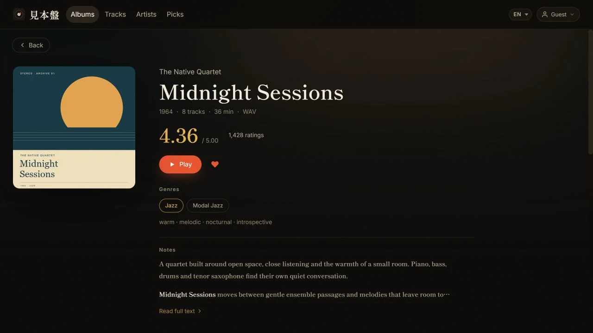

# 日常運用ガイド

[English](manual.md) · [简体中文](manual.zh.md) · [繁體中文](manual.zh-Hant.md) · [日本語](manual.ja.md) · [한국어](manual.ko.md) · [Français](manual.fr.md) · [Español](manual.es.md)

このガイドは図書館管理者向けです。パスやURLは選択されたruntimeとプライベート設定によって異なります。

## 入口

|エントリーポイント |目的 |
|---|---|
|ウェブアプリ |ブラウズ、再生、検索、お気に入り、インポート、管理 |
|ローカル受信箱 |オプションのフォルダやRAR/ZIP/7zアーカイブはPythonコンパニオンが処理 |
|`mihonban` CLI |診断、取り込み、監視、同期、プル、保存済みRYMページの処理 |

Pythonコンパニオンやデスクトッププレーヤーはウェブ再生に必須ではありません。

## 権限区分

- リスナーパスワード:認証済みコンテンツを閲覧・再生。
- 管理者パスワード:アップロード、編集、非表示、削除、お気に入り、順序付け、インフラストラクチャの設定。
- パスワードレスゲストモード:パスワード入力なしでオプションで読み取り専用リスナーアクセス。
- コンパニオンキー:オプションのローカルパイプラインのマシン認証情報。

すべてのヘルパースクリプトは、パスワードが指定されない場合にランダムなパスワードを生成します。固定のデフォルトパスワードはどこにもありません。ローカル開発のパスワードはステージディレクトリの`.dev.vars`にあります。

パスワードは管理者オーバーライド環境のブートストラップ値に保存されています。どちらかのパスワードを変更すると、既存のセッションが取り消されます。

## 再生とモバイル操作

Web のアルバム画面には、カバー、メタデータ、曲一覧、再生操作がまとまっています。架空のデモデータとオリジナルのサンプルカバーを使用しています。 [撮影について](images/README.md)。



- ウェブライブラリの**最近追加**とインポート画面の最近の追加一覧は、音盤を初めてライブラリに追加した時刻で並びます。評価やタイトルなどの編集、既存音盤の再スキャンでは先頭に移動しません。アーティスト一覧では、そのアーティストの表示対象音盤で最も新しい追加時刻を使います。同じ時刻に追加した音盤の順序は安定し、追加時刻が不明な音盤は末尾に並びます。
- 音盤・アーティスト・曲・セレクトの各ページは、ページを開いている間それぞれのスクロール位置を記憶します。戻ると前回の位置から再開し、まだ開いていないページは上部から表示されます。アルバムページとアーティストページは常に上部から開き、戻ると元の一覧の位置に戻ります。現在選択中のロゴまたはナビゲーション項目をもう一度押すと、ページ上部へスムーズに戻ります。セレクト内の「アルバム / 曲」タブも同じ動作です。
- 音量、言語、並べ替え設定はブラウザーの origin ごとに保存されます。別のホスト名やカスタムドメインを開くと新しい設定になり、音量が未設定の場合は 100% から始まります。
- 再生は元のタップ/クリックイベント内で開始されるため、Android Chrome は有音再生とシステムメディアセッションを確立できます。対応ブラウザーでは、ロック画面/通知から再生、一時停止、前後の曲、シークを操作できます。iOS Safari でバッファ済みの音声が尽きた場合、Mihonban はシステムのメディアタイムラインを一時停止し、再び再生可能になってから再開するため、無音のまま進捗だけが先行することを防ぎます。
- モバイルでは、カバーまたはミニプレーヤーの空白部分をタップするか、ミニプレーヤーを上へスワイプすると再生画面が開きます。アルバムとアーティストのリンクは個別にタップできます。
- モバイルのミニプレーヤーには、前の曲、再生／一時停止、次の曲がこの順で常に表示されます。シャッフルとリピートは再生画面全体で操作できます。
- ブックレット画像の切り替え中は読み込み状態が表示されます。タッチ端末では左右スワイプで前後の画像へ移動できます。
- アルバムグリッドはビューポート周辺のカバーを先読みし、デコードが完了するまで控えめなプレースホルダーを表示します。読み込みとデコードが完了したカバーは絞り込みや並べ替えを行っても準備済みの状態を保ち、一時的な画像読み込みエラーには少数回の遅延再試行を行います。精密ポインターを使うデスクトップのライブラリーでは、静止中のカバーの明るさと彩度をわずかに抑え、ホバー、キーボードフォーカス、または再生中には元の色へ戻します。1000 kbps 以上のビットレートは短い `M` 表記になり、ホバーすると正確な kbps を確認できます。

## 受信トレイフォルダーとアーカイブ

1. 使用許可されたアルバムフォルダやアーカイブを設定`inbox`に入れます。
2. `mihonban watch`を実行するか、`mihonban ingest --apply`で一度だけ処理します。
3. ログと検疫報告の確認;ハードな失敗は決して黙って捨てられません。
4. クラウド同期が設定されたら、`mihonban cloud sync`を実行します。

パイプラインはダイレクトフォルダ、1つのアーカイブ、そしてネストされたアーカイブをサポートしています。処理は3回変更されていないポーリングを待つため、部分的にコピーされたファイルは開かれません。作業はプライベートの一時領域で行われます。成功したソースアイテムは`_done`に移されます。ハードフォーブルとそのレポートは`_quarantine`に移動します。

パイプラインは日本語のファイル名エンコーディングを抽出し、修復し、メタデータやタグの整理を行い、ライブラリレイアウトを正規化し、結果をAPIで登録できます。曖昧なメタデータは手動で確認可能なままです。

## クラウドのソーススキャンとローカル監視

管理者ソースモジュールは、対応するRSS/Atom/Bloggerのタイトルやリンクを読み込みます。Cloudflare CronやNodeの区間は、家庭用コンピュータの電源がオフでも実行できます。音楽のダウンロードや解凍は行いません。

`mihonban watch`ローカル`inbox`、永続ファイル、7-Zip、ビートへのアクセスが必要です。Windows、macOS、Linux、またはNASで実行してください。Cloudflare Workers内で動作することはできません。

## ウェブインポート

1. 管理者としてサインインし、インポートを開きます。
2. 1つのアルバムに属するトラックを選択し、アーティスト、タイトル、年、ファイル名、順番をレビューします。
3. カバーを選択・トリミングし、意図する書き込みターゲットストレージを選択します。
4. アップロードを開始し、すべてのトラックが終わるのを待ってからページを離れます。
5. 完成したアルバムを開き、トラックを再生し、終盤近くを探す。

短時間の通信断で不完全な音声ファイルが登録されることはありません。OneDrive と Google Drive は分割アップロードを回数制限付きで再試行・再開し、WebDAV などのプロキシ型アップロードはファイル全体を再送します。Mihonban はアルバム登録前に保存先の正確なバイト数を検証し、欠落または途中で切れたオブジェクトは受理せずエラーを表示します。完成したアルバムの再生確認が終わるまで元ファイルを保持してください。

管理者はアーティストページで英字 / ローマ字名を編集できます。このアーティスト単位の値は全アルバムに反映され、後のコンパニオン同期でも保持されます。

原名をそのまま検索・並べ替えに使う場合は、この欄を空欄にしてください。Mihonban は空欄を保持し、同じ名前を重複保存せず、検索と並べ替えの内部処理だけ原名へフォールバックします。

アーティストページの Discogs 機能は候補を自動検索します。正しい候補がない場合は、公式の `discogs.com/artist/...` URL を貼り付けて直接取得でき、取り込み前に写真とプロフィールを確認・選択できます。アーティスト一覧の既定順はまず音盤数を比較し、音盤数が同じ場合だけ参加曲数を比較します。参加曲は控えめな2行目に表示され、音盤と同じ重みでは数えません。

アルバム編集では作品全体の既定アーティストを順番付きで設定します。「曲を管理」では各曲のアーティストボタンから、その曲だけのコラボレーション表記を設定できます。オプションを無効にするとアルバム表記の継承に戻ります。曲の表記は検索、プレーヤー、システムのメディア情報に反映されます。ゲストのアーティストページには実際に参加した曲だけが「参加曲」として表示され、アルバム全体が本人作品として扱われることはありません。コンパニオンとブラウザーアップローダーは、構造化された複数値の `ARTISTS` / `ALBUMARTISTS` を優先します。表示用テキストしかない場合は、明示的な `feat.` / `ft.` / `featuring` と、通常の `A & B`（例：`Marcos Valle & Azymuth`）を分割します。カンマ区切りのリストは、すべての要素がフルネーム（スペースを含む、または漢字・かな・ハングルで書かれている）の場合に分割します（例：`Kazuo Ohtani, Yoshiaki Furuta`）。いずれかの要素が 1 語だけの場合（`Earth, Wind & Fire`、`Yamashita, Tatsuro`）、後続の要素が the / his / her / their で始まる場合（`Kool & the Gang`、`Bob Marley, The Wailers`）、または MusicBrainz アーティスト ID が 1 つだけで 1 組のアーティストと示されている場合は分割しません。ライブラリですでに 1 組のアーティストとして登録されている名前（既存の `Neil & Iraiza` など）は、再スキャンや以後のインポートでも結合されたままです。手動で編集した結果が自動的に結合し直されることはありません。

ブラウザーからのインポートでは、セミコロンを明示的なアーティスト区切りとして扱います。`Artist A; Artist B` は、単一の構造化 `ARTISTS` 値に含まれる場合や MusicBrainz ID が不完全な場合でも、2 人の表記になります。アップロード前に音盤と曲の表記を確認してください。

個別のアーティスト表記がある場合、「曲を管理」に対象曲数と「すべてアルバム表記に戻す」が表示されます。1 回押して確認待ちにし、もう一度押すと全曲がアルバム表記を継承します。アルバムのアーティスト自体や未保存の曲順は変わりません。この操作はカタログのみを編集し、音声ファイルのタグは書き換えません。

管理者はアーティストページの名前の横にある「名前を編集」から、名前全体や大文字・小文字を変更できます。保存すると、非表示のアルバムやゲスト参加曲を含むライブラリ全体で同じアーティストの名前が更新され、プロフィール、お気に入り、保存先のパスは維持されます。以前の名前もアーティストへのリンク、アーティスト一覧での検索、以後のインポートで使用できます。別のアーティストが使用している名前では保存できず、アーティストが自動的に統合されることはありません。

アルバムや曲のクレジット編集でも大文字・小文字を修正できます。保存前にライブラリ全体への適用範囲を案内します。別のアーティストを選んだ場合は、そのクレジットだけが変わります。

複数枚組のインポートでは各ディスクの区分を保持し、ディスクごとに見出しを表示します。曲番号は各ディスクで 1 から始まり、「曲を管理」での並べ替えも同じディスク内だけに限られ、ディスク番号自体は変わりません。

曲を削除しても、ファイルも削除するオプションを選ばない限りファイルは残ります。アルバム削除時にもファイルを残す選択肢があります。削除と再スキャンの案内には、現在のアップロード先ではなく、そのアルバムの実際の保存先名が表示されます。確認前に保存先ごとの警告を読んでください。ファイルの削除が必ずゴミ箱への移動になるわけではありません。[ファイル削除の動作](storage.ja.md)を参照してください。

ウェブコピーがローカルライブラリに戻る必要がある場合は`mihonban cloud pull`を使いましょう。クラウドのメタデータが既存のローカルタグを更新すべき場合にのみ追加`--retag`。

コンパニオンは不足しているアルバムをダウンロードする前に、`data_dir/state/cloud_pull_incomplete/`へ永続マーカーを書き込みます。ダウンロード、クラウド詳細の取得、タグ修復、必要なアップロードと再登録がすべて成功した場合にだけ削除します。中断で`.partial`が残ったディレクトリや、有効な音声ファイルがないディレクトリは、完成済みと誤認されず自動的に再試行されます。Rcloneは古い`.partial`の既存バイトを再開せず0バイト目から再取得するため、低速回線ではwatcherとネットワークを継続して動かしてください。

## RYMメタデータ

**管理 → RYM 更新 → 評価を一括更新**から Chrome/Edge 拡張機能の ZIP を取得して展開します。拡張機能画面でデベロッパーモードを有効にし、`manifest.json` を含むフォルダを読み込みます。既存の拡張機能はファイルを置き換えて再読み込みしてください。一括更新は 1.1.0 以降で利用できます。

見本盤に管理者としてログインした状態で、拡張機能の**評価を一括更新**を押します。30日以上前・時刻不明の作品、または参照先のある全作品を選び、既存リンクを確認して一度開始するだけです。キューが RYM ページを順番に開き、**評価と評価数だけ**を更新します。同じ URL の版には取得結果を共用し、参照先のない作品は除外します。ジャンル、ディスクリプタ、順位、既存の分類提案は変わりません。

キューとライブラリのタブを開いたままにしてください。ページを開く間隔は30秒以上ですが、制限を防げる保証はありません。認証や制限で停止します。参照タブで対応してから再開してください。制限時は最低5分間待ちます。一時停止、拡張機能から開き直した後の再開、失敗分の再試行に対応します。ブラウザを閉じると停止し、定期実行や認証回避は行いません。進捗と取得した評価は新しい選択に置き換えるまで端末に保存します。パスワード、Cookie、HTML全文は保存しません。一括開始時に RYM サイトへの任意のアクセス許可を求めます。

単ページ送信も利用できます。見本盤のアドレスを設定し、RYM 作品ページを再読み込みして**現在のページを送信**し、見本盤で対象を確認します。このモードでは分類提案も取得できますが、採用には明示操作が必要です。

一覧では、未関連の作品、評価が 30 日以上前または時刻不明の作品、分類の提案、取得失敗を絞り込めます。取り込む前に作品と版を確認してください。詳細で参照先を変更すると古い評価と参照記録を消去しますが、整理済み分類は保持します。各評価項目の取得時刻または手動編集時刻を保持し、一覧には評価と評価数のうち古い時刻を表示します。取得時刻はブラウザが読んだ時刻であり、RYM 側の更新時刻ではありません。サイトの認証は元のタブで完了してください。

評価更新は**既存の主要ジャンル、二次ジャンル、ディスクリプタやその配置を変更しません**。RYM の分類は独立した提案として保存し、追加先を明示して採用するか、無視できます。無視または手動削除したタグは再提案しません。欠落項目で値を消去せず、0 は有効な値として扱い、古い取得結果は新しい値を上書きしません。コンパニオンの再走査も整理済み分類と既存・保護済み評価を保持します。ブラウザ経由の更新で音声ファイルのタグは変わりません。

**保存済み HTML の取り込み**も利用できますが、取得時刻はファイルの日付にかかわらず不明として扱い、新しいブラウザ取得結果を上書きできません。CLI による保存ページの一括処理は引き続き利用でき、同期時は同じサーバー側保護が適用されます。参照記録と無視した提案は論理データベースのエクスポートに含まれます。[データベース移行](database-migration.ja.md)を参照してください。

既定の評価順は信頼度で補正され、ごく少数の高評価だけで、同程度の評価を多数得た作品を上回りにくくしています。3.3 を安定した事前平均、50 票相当の重みとして使いますが、保存・表示する RYM の元の平均値は変更しません。未補正の平均値だけで並べる場合は「評価（平均点）」を選択してください。

## Discogs

管理者はリリースやアーティストを検索し、画像、ジャンル/スタイル、紹介文のインポートをプレビューできます。Cloudflare では管理者ブラウザーが Discogs 公式公開 API に直接接続し、公開メタデータをローカルにキャッシュして Worker の共有出口制限を回避します。Admin の個人トークンは任意で、サーバー側フォールバックだけに使用され、ブラウザーには送信されません。検索結果にカバー画像がない場合、現在表示されている候補だけがキャッシュ済みのリリース詳細を必要に応じて再利用し、画像を補完します。プレビュー用サムネイルはブラウザーが読み込む Discogs の公開画像です。設定済みストレージへ実際にインポートするファイルは、引き続き認証済み Worker を通り、Discogs ホスト、サイズ、ファイル署名の検査を受けます。

アルバム画像のインポートは冪等です。同じ Discogs リリースの画像を再度インポートしても、登録済みの画像はスキップされ、重複コピーは作成されません。

## お気に入りと非表示コンテンツ

- 管理者はアルバムや曲をお気に入りに追加し、ドラッグして順序を変更できます。新しく追加した項目はすぐ見つけられるよう先頭に入り、その後は手動で決めた順序が優先されます。
- リスナーは選定されたお気に入りページを閲覧できますが、編集はできません。
- 非表示のアルバム、曲、アーティスト、非表示コンテンツだけが持つジャンル、画像、検索結果、お気に入り項目は、リスナー向けのレスポンスから除外されます。
- 「非表示を表示」は管理者専用の表示状態で、アルバム、曲、アーティストの各一覧で共有されます。
- ヘッダーのアルバム数も同じ状態に従い、「非表示を表示」が有効な場合だけ非表示アルバムを含みます。
- アルバムギャラリーで画像を切り替えると、前の画像はすぐに消えます。選択した画像の読み込みが完了するまではインジケーターを表示し、失敗した場合は明確なエラー状態を表示します。

非表示状態を変更した後は、管理画面だけで判断せず、別のリスナーセッションでも確認してください。

## 名前付きストレージ

- 書き込み先は、今後の新しいアップロードだけに影響します。
- 既存のアルバムは、引き続きそれぞれの `storage_id` が示すストレージから読み込まれます。
- 移行では必要なオブジェクトをコピーし、すべての必須コピーが成功した後にだけバインディングを変更します。
- ソースオブジェクトは自動的に削除されません。
- 一括移動後は、再生、シーク、カバー、アバター、ギャラリーを確認してから古いコピーをアーカイブしてください。

[ストレージバックエンドとファイル移行](storage.ja.md)を参照してください。

## 管理画面

- システムステータス:アルバム/トラック/ストレージの合計と伴う心拍。
- パスワードとゲストアクセス。
- バックアップおよび復元設定:カタログ行ではなく、機密構成。
- 名前付きストレージバックエンドとライトターゲット。
- R2イメージミラーと予温。
- Discogsトークン。
- オプションのソーススキャンおよびオーディオプロキシモジュール。

設定のJSONには認証情報が含まれています。暗号化されたボールトに保存し、issue、チャット、メール、Gitには絶対に関連付けないでください。

## バックアップの習慣

|いつ |行動 |
|---|---|
|大規模なインポート後 |Node SQLiteをバックアップするかD1 SQLをエクスポートしてください;2つ目の音声コピーが存在するか確認してください |
|ストレージ/R2/モジュールの変更後 |新しい管理者設定のエクスポート JSON |
|アプリケーション更新前 |データベース + 設定 JSON + 現在のコミット/デプロイメント識別子 |
|定期的に|ファイルの存在を確認するだけでなく、復元テストを行う |

[データベースのバックアップ、移行、回復](database-migration.ja.md).

## よく使うコマンド

```text
mihonban doctor
mihonban ingest --apply
mihonban watch
mihonban cloud sync
mihonban cloud pull
mihonban cloud pull --retag
mihonban rym parse
mihonban rym match
mihonban rym write --apply

cd cloud/worker && npm test
cd cloud/web && npm test && npm run build
```

## トラブルシューティング

|症状 |行動 |
|---|---|
|受信トレイは何もしない |アイテムがサポートされて完全にコピーされているか確認し、ウォッチャーは1人だけを実行し、`data_dir/logs`を確認してください |
|アイテムは隔離されています |レポートを読みます;破損、アーカイブパスワード、サポートされていないファイル、信頼度を一致させる|
|ウェブアプリには古いアルバムがありません |カタログデータベースを復元してください;管理者設定 JSON にはアルバムが含まれていません |
|再生リターン502 |アルバムの名前付きストレージをテストし、ファイルがMihonban |
|進行しているのに音が出ない |プレーヤー、ブラウザータブ、システム出力の音量を確認し、更新後は強制再読み込みしてください。新しいブラウザー origin の既定音量は 100% です |
|シーキング失敗、iOSの持続時間が誤っていること |アップストリーム/プロキシのリターンが正しい206、`Content-Range`、そして総長を検証してください |
|画像が遅いか、グラフが制限されている |テストしてR2を有効にし、その後予備ウォーム |
|一覧カードでは表示されるが詳細ページのカバーが失敗する |一度強制再読み込みしてください。現行版は所有ストレージへフォールバックし、欠落した R2 ミラーを修復します。続く場合はストレージと R2 の両方をテストしてください |
|Google Drive既存のファイルが見つからない |現在のドライブスコープを再認証し、root IDを検証 |
|ローカルではウェブアップロードができません |`mihonban cloud pull`を実行して設定済みのrcloneリモートを確認してください |
|ログインで429 |再試行をやめて15分待ってください |
|ローカルHTTPログインは永続しません |設定`DEV_INSECURE_COOKIE=1`;公開HTTPSでは絶対に使わないでください |
