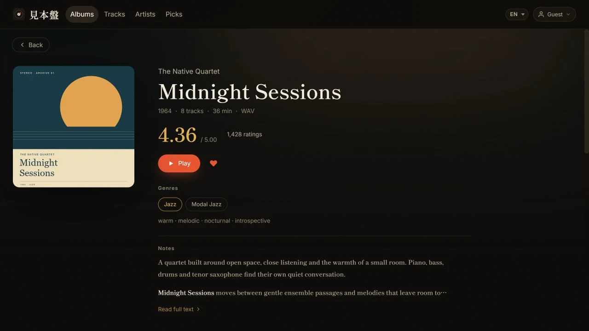

# Daily operation guide

[English](manual.md) · [简体中文](manual.zh.md) · [繁體中文](manual.zh-Hant.md) · [日本語](manual.ja.md) · [한국어](manual.ko.md) · [Français](manual.fr.md) · [Español](manual.es.md)

This guide is for library administrators. Paths and URLs depend on the selected runtime and your private configuration.

## Entry points

| Entry point | Purpose |
|---|---|
| Web app | Browse, play, search, favorite, import, and administer |
| Local inbox | Optional folders or RAR/ZIP/7z archives processed by the Python companion |
| `mihonban` CLI | Diagnose, ingest, watch, synchronize, pull, and process saved RYM pages |

The Python companion and any desktop player are not required for web playback.

## Identities

- Listener password: browse and play authenticated content.
- Administrator password: upload, edit, hide, delete, favorite, order, and configure infrastructure.
- Passwordless guest mode: optional read-only listener access without entering a password.
- Companion key: machine credential for the optional local pipeline.

All helper scripts generate random passwords when none are supplied; nothing ships with a fixed default password. Local-development passwords live in the stage directory's `.dev.vars`.

Passwords saved in Admin override environment bootstrap values. Changing either password revokes existing sessions.

## Playback and mobile interaction

The Web album page brings together artwork, metadata, tracks and playback controls. This screenshot uses fictional demo data and original example covers. [Capture details](images/README.md).



- **Recently added** in the web library and the recent-import list uses the album's original addition to the library. Editing ratings, titles or other metadata, or rescanning an existing album, does not move it to the front. The Artists list uses the most recent addition among that artist's visible albums. Albums added at the same time keep a stable order; missing addition dates sort last.
- Albums, Artists, Tracks and Picks each remember their own scroll position while the page stays open; returning to one of them resumes where you left it, and a page you have not visited yet opens at the top. Album and artist pages always open at the top, and going back returns to the list position you came from. Click the active logo or navigation item again to scroll smoothly back to the top; the Albums and Tracks tabs inside Picks follow the same rule.
- Volume, language, and sort preferences are local to each browser origin. Opening a new hostname or custom domain starts with fresh preferences; an unset volume starts at 100%.
- Playback is initiated inside the originating tap/click so Android Chrome can establish audible playback and a system media session. The lock-screen/notification controls expose play, pause, previous, next, and seeking where the browser supports them. If iOS Safari runs out of buffered audio, Mihonban freezes the native media timeline and resumes it only after audio is playable again, preventing silent progress from getting ahead of the sound.
- On mobile, tap the cover or the empty part of the mini-player, or swipe the mini-player upward, to open Now Playing. Album and artist links remain independently tappable.
- The compact mobile transport keeps previous, play/pause, and next visible in that order. Shuffle and repeat remain available in the full Now Playing view.
- Gallery images show a loading state while switching; swipe horizontally to move between pages on touch devices.
- Album grids preload covers ahead of the viewport and keep a restrained placeholder visible until decoding completes. Successfully decoded covers stay ready while filtering or sorting, and transient image failures use a small number of delayed retries. On fine-pointer desktop library screens, covers are slightly toned down at rest and return to their original color on hover, keyboard focus, or current playback. Track bitrates at or above 1000 kbps use compact `M` notation; hover the value to see the exact kbps.

## Inbox folders and archives

1. Put an album folder or an archive you are authorized to use into the configured `inbox`.
2. Run `mihonban watch`, or process once with `mihonban ingest --apply`.
3. Review logs and quarantine reports; hard failures are never silently discarded.
4. When cloud synchronization is configured, run `mihonban cloud sync`.

The pipeline supports direct folders, one archive, and nested archives. It waits for three unchanged polls before processing so partially copied files are not opened. Work occurs in a private temporary area. Successful source items move to `_done`; hard failures and their report move to `_quarantine`.

The pipeline extracts, repairs Japanese filename encoding, runs metadata/tag organization, normalizes the library layout, and can register the result with the API. Ambiguous metadata stays available for manual review.

## Cloud source scan versus local watcher

The Admin source module reads supported RSS/Atom/Blogger titles and links. Cloudflare Cron or Node's interval can run it while a home computer is off. It does not download or unpack music.

`mihonban watch` requires access to the local `inbox`, persistent files, 7-Zip, and beets. Run it on Windows, macOS, Linux, or a NAS; it cannot run inside Cloudflare Workers.

## Web import

1. Sign in as administrator and open Import.
2. Select tracks belonging to one album and review artist, title, year, filenames, and order.
3. Choose/crop a cover and select the intended write-target storage.
4. Start upload and wait for every track to finish before leaving the page.
5. Open the completed album, play a track, and seek near the end.

Brief connection loss does not silently register a partial audio file. OneDrive and Google Drive resume chunked sessions with bounded retries; proxy-style uploads such as WebDAV retry the complete file. Mihonban verifies the exact stored byte length before registering the album, and reports a failure instead of accepting a missing or truncated object. Keep the source file until the finished album has passed the playback check.

On an artist page, administrators can edit the Romanized / English name. This artist-level value updates every album by that artist and survives later companion synchronization.

Leave this field blank when the original name is already the desired search and sort name. Mihonban preserves the empty value and falls back to the original name only for search and sorting instead of storing a duplicate.

The artist-page Discogs action searches for matching candidates automatically. If the correct artist is missing, paste an official `discogs.com/artist/...` URL and fetch it directly; the dialog previews the available photo and biography before either is imported. The Artists overview ranks album count first and uses featured-track count only to break ties between artists with the same album count. Featured tracks appear on a quieter second metadata line rather than being counted as albums.

Use the album editor for the default ordered artist credit of the whole release. In Manage tracks, the artist button beside a song can add a track-specific collaboration; leave that option off to inherit the album artists. Track credits are used by search, the player and system media metadata. A guest artist's page lists only the songs they joined under Featured tracks and does not claim the whole album. The companion and browser uploader prefer structured `ARTISTS` / `ALBUMARTISTS` values. With display text only, explicit `feat.` / `ft.` / `featuring` joins are split, and so is a plain `A & B` such as `Marcos Valle & Azymuth`. A comma list is split when every part is a full name, meaning it contains a space or is written in Chinese, Japanese or Korean script (for example `Kazuo Ohtani, Yoshiaki Furuta`). The text stays whole when any part is a single word (`Earth, Wind & Fire`, `Yamashita, Tatsuro`), when a later part starts with the, his, her or their (`Kool & the Gang`, `Bob Marley, The Wailers`), or when a single MusicBrainz artist ID says it is one artist. A combined name that the library already credits as one artist, such as an existing `Neil & Iraiza`, stays joined on rescans and later imports; manual edits are never rejoined.

For browser imports, a semicolon is an explicit artist separator: `Artist A; Artist B` becomes two credits even inside one structured `ARTISTS` value or when MusicBrainz identifiers are incomplete. Review the resulting album and track credits before uploading.

When tracks have individual artist credits, Manage tracks shows their count and **Use album artists for all**. Click once to arm the action, then again to confirm; all tracks return to the album credit without changing the album artists or discarding an unsaved track order. This edits the catalog, not the audio file tags.

Administrators can choose **Edit name** beside the name on an artist page to correct capitalization or change the full name. Saving updates that artist throughout the library, including hidden albums and guest credits, while preserving the profile, favorites, and storage paths. Previous names remain usable in artist links, the Artists search, and later imports. A name used by another artist cannot be saved; artists are never automatically merged.

Capitalization can also be corrected in album and track credits. The editor explains the library-wide effect before saving. Selecting a different artist changes only the edited credit.

Multi-disc imports keep each disc identity and display a separate heading. Track numbers restart at 1 for each disc; Manage tracks permits reordering only inside the same disc and never turns a reorder into a disc reassignment.

Removing a track keeps its file unless **Also delete files** is selected; the album deletion dialog also offers a keep-files option. File deletion and rescan messages name the album’s actual storage, not the current upload target. Read the backend-specific warning before confirming: deleting a file does not always send it to a recycle bin. See [file deletion behavior](storage.md).

Use `mihonban cloud pull` when the web copy must return to the local library. Add `--retag` only when cloud metadata should update existing local tags.

Before downloading each missing album, the companion writes a persistent marker under `data_dir/state/cloud_pull_incomplete/`. It clears the marker only after download, cloud-detail lookup, tag repair, and any required upload and registration all succeed. An interrupted directory containing `.partial` files—or no valid audio—is retried automatically instead of being mistaken for a complete album. Rclone restarts an old `.partial` file from byte zero rather than resuming its bytes, so keep the watcher and network running on slow links.

## RYM metadata

Open **Admin → RYM updates → Batch update ratings** to download the Chrome/Edge extension ZIP. Unzip it, enable Developer mode in the browser’s Extensions page, choose Load unpacked, and select the folder containing `manifest.json`. For an existing installation, replace its files and click Reload; batch support starts with version 1.1.0.

To refresh a library, keep Mihonban open as administrator and click **Batch update ratings** in the extension. Choose overdue/unknown-age albums or all linked albums, review the existing source links, and start once. The queue opens one RYM page at a time and updates only **rating and rating count**. It reuses one observation for albums sharing the same source and skips albums without a valid source. Genres, descriptors, rank and classification suggestions remain unchanged.

Keep the queue and library tabs open. Navigations are spaced at least 30 seconds apart; this does not guarantee RYM will accept them. Verification or throttling pauses the queue; resolve it in the source tab, then Continue. Throttling enforces at least a five-minute cooldown. You can pause, resume after reopening through the extension, and retry failed items. Browser shutdown stops processing. There is no scheduled background service or challenge bypass. Progress and captured scores are stored on this device until a new selection replaces them; passwords, cookies and full HTML are never stored by the tool. Batch mode requests optional access to RYM when you start.

Single-page capture remains available: enter your Mihonban address, open and refresh a RYM release page, click **Send current page**, then confirm the target albums in Mihonban. This mode can also supply classification suggestions, which still require explicit adoption.

The update list can filter albums with no source, scores older than 30 days or of unknown age, classification suggestions, and failures. Confirm that the release and edition match before importing. Changing a source in Details clears the old scores and source history while preserving curated classifications. Each score field retains its own observation or manual-edit time; the list uses the older of the rating and count timestamps. “Observed” means when the browser read the page, not when RYM changed its data. Resolve site challenges in the source tab before sending.

Refreshing scores **never changes your existing primary genres, secondary genres, descriptors, or their placement**. RYM classifications are kept as separate suggestions; explicitly add each to the desired list or ignore it. Ignored or manually removed tags will not be suggested again. Missing fields do not clear existing data, zero remains a valid value, and older observations cannot replace newer ones. Companion rescans preserve curated classifications and cannot overwrite existing or protected scores. Browser updates change the catalog only, not audio-file tags.

Saved HTML remains available through **Import saved HTML**, but its observation time is unknown regardless of the file date; it cannot replace newer browser observations. The CLI can still process manually saved pages in bulk, subject to the same server-side protection when synchronizing. Source state and dismissed suggestions are included in logical database exports; see [database migration](database-migration.md).

The default rating sort is confidence-weighted so a tiny number of very high ratings does not outrank a similarly rated release with broad support. It uses a stable 3.3 prior with the weight of 50 votes without changing the stored or displayed RYM average. Choose **Rating (raw)** when the unadjusted average is the intended order.

## Discogs

Administrators can search releases or artists and preview an import of images, genres/styles, and biography text. On Cloudflare, the administrator browser calls the official public API directly and caches public metadata locally, avoiding shared Worker egress limits. The personal token in Admin is optional and is used only by the server-side fallback; it is never sent to the browser. When search results omit artwork, visible candidates lazily reuse the cached release details to fill it in. Preview thumbnails are public Discogs images loaded by the browser; files actually imported into configured storage still pass through the authenticated Worker and its Discogs-host, size, and file-signature checks.

Album-image imports are idempotent. Re-importing the same Discogs images skips the copies already registered for that release instead of creating duplicates.

## Favorites and hidden content

- Administrators can favorite albums or tracks and drag to reorder them. A newly favorited item starts at the front so it is immediately findable; manual ordering remains authoritative afterward.
- Listeners can view the curated favorites pages but cannot edit them.
- Hidden albums, tracks, artists, styles that exist only on hidden content, images, searches, and favorite entries are excluded from listener responses.
- The Show hidden toggle is an administrator-only view state shared by album, track, and artist lists.
- The header album count follows that same state: hidden albums are counted only while Show hidden is enabled.
- In the album gallery, switching images clears the previous image immediately and shows a loading indicator until the selected image is ready; a failed request shows an explicit error state.

After changing hidden state, verify with a separate listener session instead of relying only on the administrator UI.

## Named storage

- The write target affects future uploads only.
- Existing albums continue to read from their own `storage_id`.
- Migration copies required objects and changes bindings only after required copies succeed.
- Source objects are not automatically deleted.
- After a bulk move, test playback, seeking, covers, avatars, and galleries before archiving old copies.

See [Storage backends and file migration](storage.md).

## Admin areas

- System status: album/track/storage totals and companion heartbeat.
- Passwords and guest access.
- Backup and restore settings: sensitive configuration, not catalog rows.
- Named storage backends and write target.
- R2 image mirror and prewarm.
- Discogs token.
- Optional source scan and audio proxy modules.

The settings JSON contains credentials. Store it in an encrypted vault and never attach it to issues, chat, email, or Git.

## Backup routine

| When | Action |
|---|---|
| After a major import | Back up Node SQLite or export D1 SQL; confirm a second audio copy exists |
| After storage/R2/module changes | Export a new Admin settings JSON |
| Before an application update | Database + settings JSON + current commit/deployment identifier |
| Periodically | Perform a restore test rather than checking only that files exist |

See [Database backup, migration, and recovery](database-migration.md).

## Common commands

```text
mihonban doctor
mihonban ingest --apply
mihonban watch
mihonban cloud sync
mihonban cloud pull
mihonban cloud pull --retag
mihonban rym parse
mihonban rym match
mihonban rym write --apply

cd cloud/worker && npm test
cd cloud/web && npm test && npm run build
```

## Troubleshooting

| Symptom | Action |
|---|---|
| Inbox does nothing | Confirm the item is supported and fully copied, only one watcher runs, and inspect `data_dir/logs` |
| Item is quarantined | Read its report; check corruption, archive password, unsupported files, and match confidence |
| Web app has no old albums | Restore the catalog database; Admin settings JSON does not contain albums |
| Playback returns 502 | Test the album's named storage and confirm no file was moved outside Mihonban |
| Playback advances but is silent | Check player, tab, and system output volume; hard-refresh after an upgrade. A new browser origin defaults to 100% volume |
| Seeking fails or iOS duration is wrong | Verify the upstream/proxy returns correct 206, `Content-Range`, and total length |
| Images are slow or Graph is throttled | Test and enable R2, then prewarm |
| A detail-page cover fails while its card works | Hard-refresh once. Current builds fall back to the owning storage and repair a missing R2 mirror; if it persists, test both that storage and R2 |
| Google Drive cannot find existing files | Reauthorize the current Drive scope and verify root ID |
| Web upload is absent locally | Run `mihonban cloud pull` and verify the configured rclone remote |
| Login returns 429 | Stop retrying and wait 15 minutes |
| Local HTTP login does not persist | Set `DEV_INSECURE_COOKIE=1`; never use it on public HTTPS |
