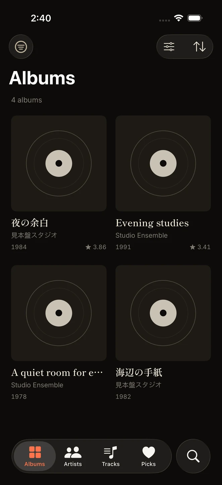
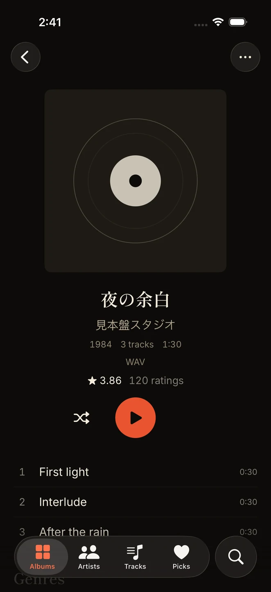
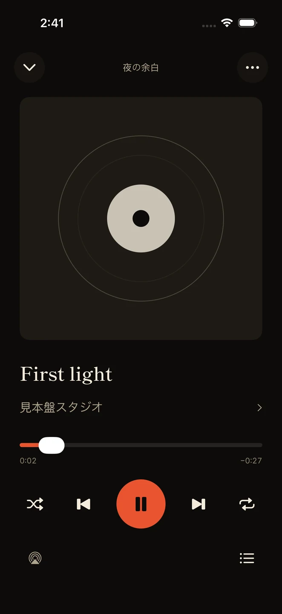
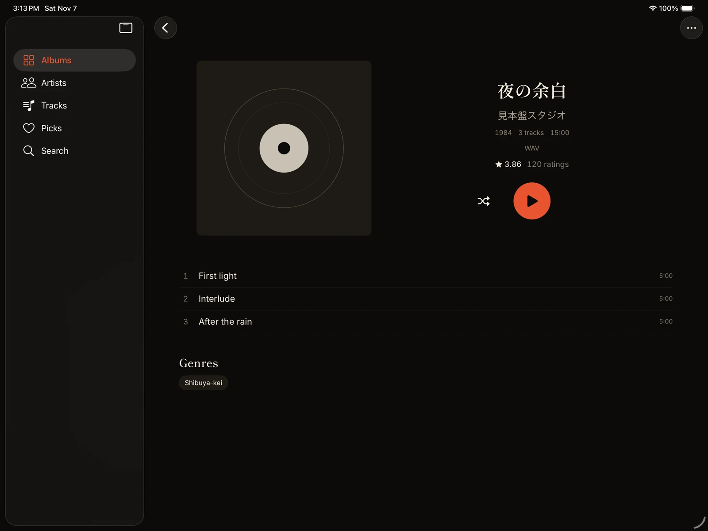

# Mihonban para iPhone y iPad

[English](README.md) · [简体中文](README.zh.md) · [繁體中文](README.zh-Hant.md) · [日本語](README.ja.md) · [한국어](README.ko.md) · [Français](README.fr.md) · [Español](README.es.md)

Cliente nativo SwiftUI para un servidor Mihonban existente, con SFBAudioEngine para la reproducción. La versión preliminar actual es 0.2.0 y requiere iOS/iPadOS 17 o posterior. No aloja el servidor ni utiliza WebView para la interfaz de escucha.

## Vista de la aplicación

Pantallas reales de la aplicación iOS nativa capturadas en los simuladores de iPhone y iPad, con datos ficticios y las portadas de sustitución integradas. [Detalles de las capturas](../docs/images/README.es.md).

| Biblioteca de iPhone | Álbum en iPhone | Reproductor de iPhone |
|:---:|:---:|:---:|
|  |  |  |

**Detalles del álbum en iPad horizontal**



## Conexión y escucha

Introduce la URL raíz del servidor, como `https://music.example.com`, y la contraseña de oyente o administrador. La contraseña vacía solo funciona si el servidor permite invitados. El interruptor opcional Guardar contraseña la almacena en el llavero para volver a conectarse. Para un servidor local usa la dirección LAN del ordenador: el `localhost` del teléfono se refiere al propio teléfono. Las sesiones HTTP locales requieren `DEV_INSECURE_COOKIE=1` en el servidor; utiliza HTTPS para el acceso remoto.

- Explora álbumes, canciones, artistas y favoritos compartidos, con búsqueda, filtros de género, ordenación, créditos de varios artistas y álbumes relacionados.
- Lee las descripciones de álbumes y artistas con el lector Markdown nativo, explora y amplía las imágenes, y comparte enlaces de álbumes y canciones mediante la hoja de compartir del sistema.
- Utiliza el minirreproductor, el reproductor completo, la cola editable, el desplazamiento temporal, la reproducción aleatoria y la repetición. El audio en segundo plano, los controles de la pantalla bloqueada y el selector de salida de audio utilizan funciones nativas de iOS.
- Guarda álbumes para escucharlos sin conexión. Las descargas muestran el progreso, permiten reintentar transferencias fallidas y se guardan por separado de la caché automática. Las transferencias en segundo plano pueden continuar con la aplicación suspendida; forzar su cierre las interrumpe.
- Vuelve a abrir la biblioteca autorizada anteriormente y la música descargada cuando el servidor no esté disponible. Si rechaza explícitamente la sesión, debes iniciar sesión de nuevo.
- Elige apariencia del sistema, clara u oscura; ajusta la caché automática entre 256 MB y 4 GB (1 GB por defecto), o desactívala. Vaciar esta caché conserva las descargas explícitas.
- Configura la precarga de la siguiente pista en Desactivada, Automática (Wi-Fi) o Siempre. La opción automática es la predeterminada y evita redes móviles, conexiones de uso medido y el modo de datos reducidos. Solo prepara la siguiente pista de la cola y puede funcionar con la caché persistente desactivada.
- Los administradores pueden modificar favoritos compartidos, metadatos y portadas, mostrar u ocultar álbumes y confirmar la eliminación con o sin los archivos almacenados. La configuración completa del servidor, la importación/migración masiva y las actualizaciones RYM asistidas por navegador se realizan en la aplicación Web.

La interfaz admite inglés, japonés, coreano, francés, español, chino simplificado y chino tradicional. Las orientaciones vertical y horizontal, Dynamic Type y los diseños de iPad tienen pruebas de regresión independientes. Los formatos admitidos dependen de SFBAudioEngine y los códecs incluidos; las pruebas verifican la decodificación y el desplazamiento temporal de archivos MP3, FLAC y Vorbis sintéticos.

## Compilación

Usa macOS, Xcode compatible con las funciones de Swift 6.2 utilizadas por el código, XcodeGen, Python 3 y FFmpeg. El [workflow iOS](../.github/workflows/mobile.yml) registra el entorno y la versión exacta de Xcode usados en CI (actualmente `macos-26` y Xcode 26.6). Ejecuta la preparación del código y los comandos de compilación desde la raíz del repositorio:

```sh
brew install xcodegen ffmpeg
python3 -I ios/tools/check-l10n.py
python3 -I ios/tools/check-fonts.py
mkdir -p ios/TestFixtures ios/Resources/ThirdParty
ffmpeg -v error -f lavfi -i 'sine=frequency=440:duration=8:sample_rate=44100' -ac 2 -c:a libmp3lame -q:a 3 ios/TestFixtures/tone.mp3
ffmpeg -v error -f lavfi -i 'sine=frequency=440:duration=8:sample_rate=44100' -ac 2 -c:a flac ios/TestFixtures/tone.flac
ffmpeg -v error -f lavfi -i 'sine=frequency=440:duration=8:sample_rate=44100' -ac 2 -c:a vorbis -strict experimental -q:a 4 ios/TestFixtures/tone.ogg
xcodegen generate --spec ios/project.yml
xcodebuild -resolvePackageDependencies -project ios/Mihonban.xcodeproj -scheme Mihonban -clonedSourcePackagesDirPath .spm
python3 -I ios/tools/acknowledgements.py .spm/checkouts ios/Resources/ThirdParty/Acknowledgements.txt
xcodegen generate --spec ios/project.yml
open ios/Mihonban.xcodeproj
```

SFBAudioEngine está fijado a una revisión en `project.yml`. Si se proporciona un `ios/Package.resolved` revisado, cópialo a `ios/Mihonban.xcodeproj/project.xcworkspace/xcshareddata/swiftpm/` antes de resolver los paquetes, como hace CI. CI incluye el archivo de bloqueo resuelto entre sus artefactos. El proyecto Xcode generado, las copias de las dependencias, el audio sintético y los resultados de compilación se excluyen de Git; los iconos, la fuente, el catálogo de traducción y las tablas de búsqueda suministrados son recursos del código fuente.

Selecciona un simulador de iPhone o iPad y ejecuta el scheme Mihonban. Para un dispositivo físico configura tu equipo de desarrollo y los ajustes de firma. CI genera una IPA **sin firmar**; descargarla no permite instalarla sin un proceso adecuado de firma o instalación lateral. El workflow también empaqueta sumas de comprobación, avisos de terceros y objetos de compilación que permiten volver a enlazar. Los artefactos se obtienen de [ejecuciones iOS correctas](https://github.com/hanfdev/mihonban/actions/workflows/mobile.yml) y caducan según su retención; no se publica automáticamente en la App Store.

## Pruebas

Inicia el servidor de datos de prueba en otra terminal antes de ejecutar el scheme de pruebas de Xcode:

```sh
python3 -I ios/tools/fixture-server.py ios/TestFixtures
```

El servidor escucha en el puerto de bucle local 8766 y proporciona medios sintéticos y datos de prueba API. Las pruebas abarcan contratos API, inicio sin conexión, actualización del catálogo, favoritos, transiciones de cola, caché/descargas, decodificación/desplazamiento temporal, tipografía, diseño y navegación nativa. CI ejecuta la suite de iPhone y un subconjunto independiente para iPad, y sube informes y capturas. Las capturas seleccionadas para documentación se guardan en `docs/images/`; los conjuntos completos y los informes siguen siendo productos generados fuera del control de versiones. No se requiere una cuenta de producción ni una colección musical. Compilar iOS o ejecutar un simulador requiere macOS; superar solo las comprobaciones Python portátiles no verifica la compilación Swift ni el comportamiento del dispositivo.

## Mantenimiento de recursos generados

Tras editar las traducciones Web compartidas o los alias de búsqueda, regenera los catálogos versionados y revisa sus diferencias:

```sh
node ios/tools/export-locales.mjs
node ios/tools/export-search.mjs
python3 -I ios/tools/check-l10n.py
python3 -I ios/tools/check-fonts.py
```

Solo al cambiar imágenes o la cobertura tipográfica, instala Pillow, fontTools y Brotli en un entorno Python de desarrollo y ejecuta `python3 ios/tools/prepare-assets.py .`. Regenera el icono/logotipo y la fuente de respaldo a partir del origen fijado y los recursos Web compartidos; no hace falta para una compilación normal.

El proyecto utiliza AGPL-3.0-only. Las fuentes incluidas conservan sus SIL Open Font Licenses. SFBAudioEngine y sus dependencias de códecs conservan sus propias licencias; al distribuir compilaciones, mantén los avisos generados y la información de las dependencias.

[Volver a la documentación del proyecto](../README.es.md)
